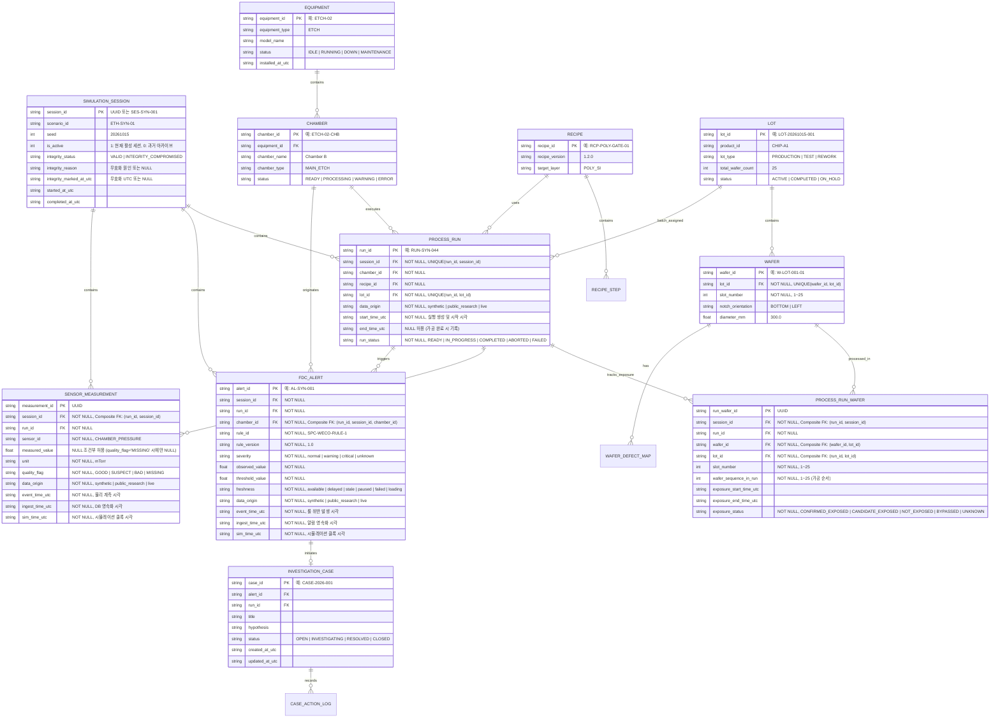

# FAB ONE — 반도체 도메인 데이터 계약 및 공학 계산 명세서 v0.5

- **문서 ID:** ARCH-DOC-002
- **상태:** PROPOSED (A01 기획자 및 프로젝트 오너 승인 대기)
- **개정 이력:**
  - v0.1 (2026-10-15): 초안 작성
  - v0.2 (2026-10-15): A01 검토의견 반영 (Cpk/Ppk 분리, Wafer-Run 계보)
  - v0.3 (2026-10-15): A04 1차 독립 검증 결과 수용 및 A01 수정 지시 반영
    - [F01] 활성 세션 수명주기 불변식 명문화
    - [F02] 복합 외래키 부모 UNIQUE(run_id, session_id) 추가
    - [F06] 단측 규격 처리, 부분군 계수($d_2, c_4$) 참조표, Die Yield 분모 0 시 반환 타입 고정
    - [F08] SPC 이상 경고의 비인과성 공학 원칙 독립 섹션(§3.5) 신설
    - [F09] API/TypeScript 계약 필드명 통일(`capabilityType`, `sigmaEstimator`)
  - v0.4 (2026-10-15): A04 2차 독립 검증 결과 수용 및 A01 통합 수정 지시 반영
    - [F02] SQLite 복합 FK NULL 면제 우회 차단: 계보 자식 컬럼에 명시적 `NOT NULL` 및 `CHECK` 제약조건 강제
    - [F06] 부분군 계수($d_2, c_4$) $m=2\sim10$ 전체 수록, $m \ge 10$ 합동 분산($s_{\text{pooled}}/c_4$) 및 최소 부분군 수($k \ge 5$) 명시
    - [F09] `PROCESS_RUN` ERD에 `data_origin` 컬럼 추가 및 TypeScript `ProcessRun` 인터페이스 신설
  - v0.5 (2026-10-15): A04 3차 독립 검증 결과 수용 및 A01 잔여 5항목 통합 수정 지시 반영
    - [F02] `sensor_measurement` DDL에 `chk_measured_value_quality` CHECK 제약조건 강제: `quality_flag = 'MISSING'` 시 `measured_value IS NULL` 필수, `GOOD/SUSPECT/BAD` 시 `measured_value IS NOT NULL` 필수 강제 (`GOOD+NULL` 및 `MISSING+non-NULL` 거절 반례 명시)
    - [F06] 부분군 표본수 경계($k < 5$ vs $N < 20$) 처리 규칙 분리, 상태 우선순위 계층(`EVALUATION_INVALID > ASSUMPTION_WARNING > ONE_SIDED_SPEC_EVALUATED > OK`), 다중 경고 배열(`warnings: string[]`) 규격화 및 골든 픽스처 수록
    - [F09] `PROCESS_RUN` ERD/DDL과 TypeScript 인터페이스 완전 통일: `run_status` 5개 표준 상태(`READY`, `IN_PROGRESS`, `COMPLETED`, `ABORTED`, `FAILED`), 필수 `start_time_utc: string` 및 선택적 `end_time_utc?: string | null` 일치. §7에 `fixtures/manifest.json` 필수 스키마 및 검증 실패 오류 코드 명시
- **작성자:** A02 (수석 소프트웨어 개발 에이전트)
- **관련 Issue / PR:** Issue [#1](https://github.com/Junebooky/semi_fab/issues/1), Issue [#8](https://github.com/Junebooky/semi_fab/issues/8), Issue [#12](https://github.com/Junebooky/semi_fab/issues/12), Draft PR [#2](https://github.com/Junebooky/semi_fab/pull/2), QA PR [#3](https://github.com/Junebooky/semi_fab/pull/3), Design PR [#7](https://github.com/Junebooky/semi_fab/pull/7), PR [#10](https://github.com/Junebooky/semi_fab/pull/10)

---

## 1. 개요 및 설계 목적

본 문서는 반도체 제조 공정(특히 식각/Etch 공정) 및 설비 시뮬레이션에 필요한 **핵심 도메인 엔티티 관계, 스키마, 식별자 체계, 시간 및 단위 규약, 그리고 공학 계산 공식(수율, 식각률, 공정능력지수/공정성능지수)**의 기술 표준을 정의한다.

A04 QA 독립 검증 결과(Issue #12) 및 A01 기획 에이전트의 공식 수정 지시(PR #10)를 충실히 반영하여, 구현 및 테스트 단계에서 모호함 없이 기계적으로 검증 가능한 계약(Contract)을 수립한다.

---

## 2. 도메인 엔티티 관계 모델 (ERD)



---

## 3. 식별자, 데이터 모델 및 데이터 계보 무결성 (P0 대응)

### 3.1 식별자 명명 규칙
- 모든 기본 키(PK)는 고유하며 시스템 전역에서 유일하다.
- 합성 데이터 식별자는 실제 FAB과의 혼동을 방지하기 위해 접두사 또는 접미사에 `SYN`을 포함할 수 있다. (예: `RUN-SYN-044`, `AL-SYN-001`)

### 3.2 복합 외래키(Composite FK) 및 NOT NULL 제약을 통한 계보 무결성 ([F02] 보완)

#### 1) SQLite 복합 외래키의 NULL 면제(NULL Exemption) 취약점과 해결 원칙
SQLite 공식 규약([SQLite Foreign Key Support](https://www.sqlite.org/foreignkeys.html))에 따르면:
> "자식 테이블의 복합 외래키(Composite Foreign Key) 구성 컬럼 중 **단 하나라도 `NULL`인 경우, SQLite는 외래키 제약조건 검사를 완전히 건너뛰고(skip) 제약조건이 충족된 것으로 간주**하며, `PRAGMA foreign_key_check` 역시 이를 무결성 위반으로 감지하지 못한다."

이로 인해 DDL에 명시적인 `NOT NULL` 제약조건이 누락되면 다음과 같은 심각한 데이터 계보 우회가 발생한다:
- `PROCESS_RUN_WAFER`에 `session_id = NULL` 삽입 시 `(run_id, session_id)` FK 검사가 스킵되어 부모 Run과 세션이 불일치하는 유령 레코드 발생.
- `PROCESS_RUN_WAFER`에 `lot_id = NULL` 삽입 시 `(wafer_id, lot_id)` 및 `(run_id, lot_id)` 검사가 모두 스킵되어 교차 Lot 검증이 무력화됨.
- `SENSOR_MEASUREMENT`에 `session_id = NULL` 삽입 시 세션 검증 스킵.
- `FDC_ALERT`에 `chamber_id = NULL` 삽입 시 챔버 계보 검증 스킵.

따라서 단순 복합 외래키 선언에 그치지 않고, 모든 계보 참조 컬럼에 **명시적 `NOT NULL`과 공백 방지 `CHECK` 제약조건**을 스키마 레벨에서 물리적으로 강제한다.

#### 2) 스키마 DDL 레벨의 복합 유니크, 복합 외래키, NOT NULL 및 품질 CHECK 강제 규약
1. **부모 테이블(`PROCESS_RUN`, `WAFER`) 복합 제약조건 및 DDL:**
   - `WAFER`: `CONSTRAINT uq_wafer_lot UNIQUE (wafer_id, lot_id)`
   - `PROCESS_RUN`: 2열/3열 복합 참조를 위한 유니크 키 및 상태/시간 제약조건 완비:
   ```sql
   -- PROCESS_RUN: 시뮬레이션 세션, 챔버, 레시피, 로트 연결 부모 테이블
   CREATE TABLE process_run (
       run_id TEXT NOT NULL CHECK (length(trim(run_id)) > 0),
       session_id TEXT NOT NULL CHECK (length(trim(session_id)) > 0),
       lot_id TEXT NOT NULL CHECK (length(trim(lot_id)) > 0),
       recipe_id TEXT NOT NULL CHECK (length(trim(recipe_id)) > 0),
       chamber_id TEXT NOT NULL CHECK (length(trim(chamber_id)) > 0),
       equipment_id TEXT NOT NULL CHECK (length(trim(equipment_id)) > 0),
       data_origin TEXT NOT NULL CHECK (data_origin IN ('synthetic', 'public_research', 'live')),
       start_time_utc TEXT NOT NULL CHECK (length(trim(start_time_utc)) > 0),
       end_time_utc TEXT, -- 가공 진행 중에는 NULL, 가공 완료/중단 시 타임스탬프 기록
       run_status TEXT NOT NULL CHECK (run_status IN ('READY', 'IN_PROGRESS', 'COMPLETED', 'ABORTED', 'FAILED')),
       PRIMARY KEY (run_id),
       CONSTRAINT uq_run_session UNIQUE (run_id, session_id), -- foreign key mismatch 방지 (SENSOR_MEASUREMENT, PROCESS_RUN_WAFER 참조용)
       CONSTRAINT uq_run_lot UNIQUE (run_id, lot_id),         -- 교차 Lot 투입 방지 (PROCESS_RUN_WAFER 참조용)
       CONSTRAINT uq_run_session_chamber UNIQUE (run_id, session_id, chamber_id), -- FDC_ALERT 3열 참조용
       FOREIGN KEY (session_id) REFERENCES simulation_session(session_id) ON DELETE RESTRICT
   );
   ```

2. **자식 테이블 복합 외래키 및 NOT NULL / CHECK / 품질 일치 제약조건 ([F02] 보완):**
   ```sql
   -- PROCESS_RUN_WAFER: 세션, 공정실행, 웨이퍼, 로트 계보의 완전한 NOT NULL 및 복합 FK
   CREATE TABLE process_run_wafer (
       run_wafer_id TEXT PRIMARY KEY,
       session_id TEXT NOT NULL CHECK (length(trim(session_id)) > 0),
       run_id TEXT NOT NULL CHECK (length(trim(run_id)) > 0),
       wafer_id TEXT NOT NULL CHECK (length(trim(wafer_id)) > 0),
       lot_id TEXT NOT NULL CHECK (length(trim(lot_id)) > 0),
       slot_number INTEGER NOT NULL CHECK (slot_number BETWEEN 1 AND 25),
       wafer_sequence_in_run INTEGER NOT NULL CHECK (wafer_sequence_in_run BETWEEN 1 AND 25),
       exposure_start_time_utc TEXT,
       exposure_end_time_utc TEXT,
       exposure_status TEXT NOT NULL CHECK (exposure_status IN ('CONFIRMED_EXPOSED', 'CANDIDATE_EXPOSED', 'NOT_EXPOSED', 'BYPASSED', 'UNKNOWN')),
       FOREIGN KEY (wafer_id, lot_id) REFERENCES wafer(wafer_id, lot_id) ON DELETE RESTRICT,
       FOREIGN KEY (run_id, lot_id) REFERENCES process_run(run_id, lot_id) ON DELETE RESTRICT,
       FOREIGN KEY (run_id, session_id) REFERENCES process_run(run_id, session_id) ON DELETE RESTRICT
   );

   -- SENSOR_MEASUREMENT: 세션-Run 일치 및 계측 결측치(NULL) 품질 정합성 강제 ([F02] 해결)
   CREATE TABLE sensor_measurement (
       measurement_id TEXT PRIMARY KEY,
       session_id TEXT NOT NULL CHECK (length(trim(session_id)) > 0),
       run_id TEXT NOT NULL CHECK (length(trim(run_id)) > 0),
       sensor_id TEXT NOT NULL CHECK (length(trim(sensor_id)) > 0),
       measured_value REAL,
       unit TEXT NOT NULL CHECK (length(trim(unit)) > 0),
       quality_flag TEXT NOT NULL CHECK (quality_flag IN ('GOOD', 'SUSPECT', 'BAD', 'MISSING')),
       data_origin TEXT NOT NULL CHECK (data_origin IN ('synthetic', 'public_research', 'live')),
       event_time_utc TEXT NOT NULL,
       ingest_time_utc TEXT NOT NULL,
       sim_time_utc TEXT NOT NULL,
       CONSTRAINT chk_measured_value_quality CHECK (
           (quality_flag = 'MISSING' AND measured_value IS NULL) OR
           (quality_flag IN ('GOOD', 'SUSPECT', 'BAD') AND measured_value IS NOT NULL)
       ),
       FOREIGN KEY (run_id, session_id) REFERENCES process_run(run_id, session_id) ON DELETE RESTRICT
   );

   -- FDC_ALERT: 세션-Run-챔버 일치
   CREATE TABLE fdc_alert (
       alert_id TEXT PRIMARY KEY,
       session_id TEXT NOT NULL CHECK (length(trim(session_id)) > 0),
       run_id TEXT NOT NULL CHECK (length(trim(run_id)) > 0),
       chamber_id TEXT NOT NULL CHECK (length(trim(chamber_id)) > 0),
       rule_id TEXT NOT NULL,
       rule_version TEXT NOT NULL,
       severity TEXT NOT NULL CHECK (severity IN ('normal', 'warning', 'critical', 'unknown')),
       observed_value REAL NOT NULL,
       threshold_value REAL NOT NULL,
       freshness TEXT NOT NULL CHECK (freshness IN ('available', 'delayed', 'stale', 'paused', 'failed', 'loading')),
       data_origin TEXT NOT NULL CHECK (data_origin IN ('synthetic', 'public_research', 'live')),
       event_time_utc TEXT NOT NULL,
       ingest_time_utc TEXT NOT NULL,
       sim_time_utc TEXT NOT NULL,
       FOREIGN KEY (run_id, session_id, chamber_id) REFERENCES process_run(run_id, session_id, chamber_id) ON DELETE RESTRICT
   );
   ```

#### 3) 독립 최소 반례 수용 조건 및 검증 기준 (A01/A04 기계적 수용 조건)
- **전제 조건:** SQLite 연결마다 반드시 `PRAGMA foreign_keys = ON;`을 실행한다.
- **테스트 매트릭스 및 수용 기대값:**
  1. **정상 계보 INSERT (PASS):** 일치하는 `session_id`, `run_id`, `lot_id`, `wafer_id`, `chamber_id` 레코드 삽입 시 에러 없이 커밋 성공.
  2. **교차 Lot INSERT 거절 (REJECT):** `PROCESS_RUN`의 `lot_id`와 다른 Lot 소속의 웨이퍼를 `PROCESS_RUN_WAFER`에 매핑 시도 시 `sqlite3.IntegrityError: FOREIGN KEY constraint failed` 발생 및 롤백.
  3. **잘못된 Session INSERT 거절 (REJECT):** `PROCESS_RUN`의 `session_id`와 다른 세션을 지정한 `SENSOR_MEASUREMENT` 또는 `PROCESS_RUN_WAFER` 삽입 시 `sqlite3.IntegrityError: FOREIGN KEY constraint failed` 발생 및 롤백.
  4. **잘못된 Chamber INSERT 거절 (REJECT):** `PROCESS_RUN`의 `chamber_id`와 다른 챔버를 지정한 `FDC_ALERT` 삽입 시 `sqlite3.IntegrityError: FOREIGN KEY constraint failed` 발생 및 롤백.
  5. **NULL 우회 삽입 거절 (4종 REJECT):**
     - `PROCESS_RUN_WAFER(session_id = NULL)` $\to$ `sqlite3.IntegrityError: NOT NULL constraint failed: process_run_wafer.session_id`.
     - `PROCESS_RUN_WAFER(lot_id = NULL)` $\to$ `sqlite3.IntegrityError: NOT NULL constraint failed: process_run_wafer.lot_id`.
     - `SENSOR_MEASUREMENT(session_id = NULL)` $\to$ `sqlite3.IntegrityError: NOT NULL constraint failed: sensor_measurement.session_id`.
     - `FDC_ALERT(chamber_id = NULL)` $\to$ `sqlite3.IntegrityError: NOT NULL constraint failed: fdc_alert.chamber_id`.
  6. **빈 문자열("") 우회 삽입 거절 (REJECT):** `CHECK (length(trim(col)) > 0)`에 의해 `sqlite3.IntegrityError: CHECK constraint failed` 발생 및 롤백.
  7. **정상 결측치 허용 (PASS):** `SENSOR_MEASUREMENT(measured_value = NULL, quality_flag = 'MISSING')`는 결측치로 정상 삽입 성공.
  8. **정상 유효 계측치 허용 (PASS):** `SENSOR_MEASUREMENT(measured_value = 120.45, quality_flag = 'GOOD')`는 정상 삽입 성공.
  9. **품질 플래그-NULL 불일치 삽입 거절 (2종 REJECT, [F02] 해결):**
     - `SENSOR_MEASUREMENT(measured_value = NULL, quality_flag = 'GOOD')` $\to$ `sqlite3.IntegrityError: CHECK constraint failed: chk_measured_value_quality` 발생 및 롤백.
     - `SENSOR_MEASUREMENT(measured_value = 120.45, quality_flag = 'MISSING')` $\to$ `sqlite3.IntegrityError: CHECK constraint failed: chk_measured_value_quality` 발생 및 롤백.
  10. **무결성 검사 기대값:** 정상 데이터 적재 후 `PRAGMA foreign_key_check;` 실행 결과가 빈 리스트 `[]` (0건) 반환.

### 3.3 Wafer $\to$ Run 노출 계보 및 Lot/Wafer 상태 구분
- **도메인 특성:** 식각 챔버(Etch Chamber)는 단일 웨이퍼 가공(Single-wafer processing) 방식이므로, Lot 단위 할당과 챔버 내 실제 노출은 분리하여 추적한다.
- **`PROCESS_RUN_WAFER` 노출 상태 (`exposure_status`):**
  - `CONFIRMED_EXPOSED`: 알람 시간 윈도우 내 챔버 가공이 확정된 웨이퍼.
  - `CANDIDATE_EXPOSED`: 동일 Lot 소속이며 가공 대기/인접 투입으로 영향 가능성이 있는 후보 웨이퍼.
  - `NOT_EXPOSED`: 미투입 또는 이상 발생 전 가공 완료 웨이퍼.
  - `BYPASSED`: 더미/테스트 웨이퍼 또는 건너뛴 웨이퍼.
  - `UNKNOWN`: 추적 정보 불충분.
- **UI 표기 규약:** 챔버 이상 알람 시 화면에 "Lot 전체 결함 확정" 표현을 절대 금지하며, 반드시 **'영향 가능 후보 Lot/Wafer'**로 표기한다.

### 3.4 시뮬레이션 세션(`SIMULATION_SESSION`) 수명주기 및 불변식 ([F01] 해결)
- **세션 상태 모델 및 불변식 (Invariants):**
  1. **초기/미초기화 상태 (Uninitialized, 0개 활성 허용):** 빈 데이터베이스 생성 직후 또는 최초 앱 기동 전에는 `is_active = 1`인 세션이 0개일 수 있다. 이 상태에서 대시보드는 에러가 아닌 `UNINITIALIZED_SIMULATION` 안내 화면 및 시나리오 시작 액션을 노출한다.
  2. **서비스 가동 상태 (Operational Invariant, 정확히 1개):** 시뮬레이션이 시작된 이후에는 시스템 내에 **정확히 1개의 세션만 `is_active = 1`**을 유지한다. DB의 부분 유니크 인덱스(`CREATE UNIQUE INDEX idx_unique_active_session ON simulation_session(is_active) WHERE is_active = 1;`)가 복수 활성 세션을 물리적으로 차단한다.
  3. **원자적 세션 전환 (Atomic Handover in Reset):** 시뮬레이터 리셋 시 비활성화와 신규 세션 생성을 분리하지 않고 **단일 트랜잭션**으로 묶어 실행한다:
     ```sql
     BEGIN IMMEDIATE;
     UPDATE simulation_session SET is_active = 0, completed_at_utc = :now WHERE is_active = 1;
     INSERT INTO simulation_session (session_id, scenario_id, seed, is_active, started_at_utc)
     VALUES (:new_session_id, :scenario_id, :seed, 1, :now);
     COMMIT;
     ```
     - 실패 시 전체가 ROLLBACK되므로 활성 세션이 0개로 유실되는 세션 고아(Orphan) 현상을 방지한다.
  4. **쓰기 가드레일:** 공정 실행 및 계측치 기록 서비스는 `is_active = 1` 세션이 없으면 쓰기를 거부하고 `NO_ACTIVE_SIMULATION_SESSION`을 반환한다.

**F07 영속 무효화 ERD/DDL/TS 정합성:** `is_active`는 서비스 활성 표시일 뿐 데이터 신뢰성 표시가 아니다. `integrity_status`는 `VALID`(정상) 또는 종결 상태 `INTEGRITY_COMPROMISED`이며, 오류 원인 및 UTC 시각을 별도 보존한다. 신규 SQLite의 정식 세션·예약 가드 스키마 조각은 다음과 같다. 기존 DB 마이그레이션은 동등한 컬럼/제약과 선행 이력 검사를 보장해야 한다.

```sql
CREATE TABLE simulation_session (
    session_id TEXT PRIMARY KEY,
    scenario_id TEXT NOT NULL,
    seed INTEGER NOT NULL,
    is_active INTEGER NOT NULL CHECK (is_active IN (0, 1)),
    integrity_status TEXT NOT NULL DEFAULT 'VALID'
        CHECK (integrity_status IN ('VALID', 'INTEGRITY_COMPROMISED')),
    integrity_reason TEXT,
    integrity_marked_at_utc TEXT,
    started_at_utc TEXT NOT NULL,
    completed_at_utc TEXT,
    CHECK (
        (integrity_status = 'VALID'
          AND integrity_reason IS NULL AND integrity_marked_at_utc IS NULL)
        OR (integrity_status = 'INTEGRITY_COMPROMISED'
          AND integrity_reason IS NOT NULL AND integrity_marked_at_utc IS NOT NULL)
    )
);
CREATE UNIQUE INDEX idx_unique_active_session
  ON simulation_session(is_active) WHERE is_active = 1;

-- 제어 메타데이터: 의도적으로 동적 이력 삭제에 종속되는 FK 없음
CREATE TABLE session_ingest_guard (
    session_id TEXT PRIMARY KEY,
    guard_state TEXT NOT NULL CHECK (guard_state IN ('IDLE', 'OPEN', 'QUARANTINED')),
    batch_token TEXT,
    guard_updated_at_utc TEXT NOT NULL,
    CHECK ((guard_state = 'OPEN' AND batch_token IS NOT NULL)
       OR (guard_state IN ('IDLE', 'QUARANTINED') AND batch_token IS NULL))
);
```

- **F01 보존:** 새 시뮬레이션 세션과 해당 `IDLE` 가드 행의 INSERT를 같은 트랜잭션으로 처리한다. 기존 활성 세션 유니크 인덱스와 Soft-Reset 원자적 활성 교체 규칙은 변경하지 않는다.
- **F07 사전 예약 필수:** 이벤트·`process_run`·`sensor_measurement`·`fdc_alert` 저장 전에 `is_active=1`, `integrity_status='VALID'`, `guard_state='IDLE'`을 원자 확인하고 `OPEN + batch_token`으로 CAS 1행 전이하여 **별도 COMMIT**. 실제 배치 트랜잭션은 시작 시 유효 소유 토큰 확인, 성공 시 이벤트 저장과 `OPEN → IDLE`을 함께 COMMIT한다. 충돌이면 전체 배치 ROLLBACK 뒤 **다른 트랜잭션**에서 세션 `VALID → INTEGRITY_COMPROMISED` + 사유/시각 및 가드 `OPEN → QUARANTINED`를 각각 CAS 1행 확인하고 함께 COMMIT한다. 선행 커밋 이벤트는 물리적으로 유지되나 일반 조회·통계/CSV에 제공하지 않는다.
- **재기동/오류 시 fail-closed:** 격리 COMMIT 이전 크래시에도 `OPEN`이 내구적으로 남아 쓰기와 일반 결과 조회를 막는다. 재기동 때 남은 `OPEN`은 자동 IDLE 복구 금지, `INTERRUPTED_BATCH_REQUIRES_REVIEW` 사유로 위 격리 COMMIT을 재시도한다. 실패 중에도 쓰기 금지. 가드 누락/상태 불일치도 정상으로 간주하지 않으며, 기존 데이터 감사 없는 `IDLE` 생성 금지. `INTEGRITY_COMPROMISED`는 `is_active=0`이 되어도 유지, 자동 `VALID` 복귀 금지. 정상 결과 조회는 반드시 세션 `VALID` **및** 가드 `IDLE` 조건을 함께 만족해야 한다. 상세 절차: 재현성 계약 §5.2.

### 3.5 SPC 이상 경고의 비인과성 공학 원칙 ([F08] 신설)
반도체 FDC 및 통계적 공정 관리(SPC)의 공학적 한계를 명확히 규정한다:
- **핵심 원칙:** FDC 이상 알람 및 관리한계 이탈(Outlier/Alarm)은 **"원인 조사를 시작할 근거가 됨을 나타낼 뿐, 해당 로트/웨이퍼의 물리적 결함 확정이나 설비의 특정 고장 원인을 단정하는 인과관계를 증명하지 않는다."**
- **용어 및 UI 통제:** 모든 대시보드 화면, 알람 메시지, 조사 케이스 워크플로에서 "결함 확정", "불량 판정", "원인 규명 완료" 등의 단정적 어휘를 금지하며, 반드시 "이상 징후 관측", "영향 가능 후보 조사", "의심 원인 가설" 수준의 객관적 표현을 사용한다.

---

## 4. 시간 축, 타임존 및 지연 감지 규약

### 4.1 3대 시간 축의 분리 및 영속화
1. **사건 발생 시각 (`event_time_utc`):** 센서에서 물리적 측정치가 생성되거나 FDC 룰 위반 조건이 충족된 시점.
2. **수집 영속 시각 (`ingest_time_utc`):** 수집 파이프라인 또는 백엔드가 해당 데이터를 DB에 기록한 시스템 시점.
3. **가상 시뮬레이션 시각 (`sim_time_utc`):** 시뮬레이터 내부 가상 클록의 시점.

### 4.2 타임존 저장 및 표기 원칙
- **스토리지 및 API 통신:** **엄격한 ISO 8601 UTC** (`YYYY-MM-DDTHH:MM:SS.sssZ`) 문자열만 허용.
- **UI 표기:** 기본 표시는 **한국 표준시 (`Asia/Seoul`, KST, UTC+09:00)** 적용 (`2026-10-15 10:24:03 KST`).

### 4.3 품질 플래그(Quality)와 스트림 신선도(Freshness) 경계 ([F09] 반영)
- **개별 샘플 품질 (`quality_flag`):** `GOOD` (정상), `SUSPECT` (이상 의심), `BAD` (센서 결함), `MISSING` (미도착 null). 결측치를 0으로 왜곡 렌더링하지 않는다.
- **스트림 신선도 (`freshness`):** 평가 시점 $T_{\text{sim}}$과 마지막 정상 수신 시각 $T_{\text{last\_good}}$ 간의 경과 시간 $\tau = T_{\text{sim}} - T_{\text{last\_good}}$를 기준으로 상호 배타적 판정.
  - **경계 조건 처리 ([F09] 해결):**
    1. **정상 샘플이 1건도 없는 초기 상태 ($T_{\text{last\_good}}$ 부재):** 스트림 시작 시점 $T_{\text{start}}$ 기준 경과 시간 $\tau_{\text{init}} = T_{\text{sim}} - T_{\text{start}}$를 평가하여, $\tau_{\text{init}} \le 1.0 \times \Delta t$이면 `loading`, 초과하면 `stale`로 판정한다.
    2. **시뮬레이션 시간 역전 ($T_{\text{sim}} < T_{\text{last\_good}}$):** 클록 리셋 또는 시크(Seek) 동작으로 발생하며, 즉시 `paused` 상태로 전이하고 클록 재동기화(`clock_resync_required`)를 수행하여 $\tau < 0$ 모호성을 방지한다.
  - **상태 우선순위:** `paused` $>$ `failed` $>$ `loading` $>$ `stale` ($\tau > 3\Delta t$) $>$ `delayed` ($1\Delta t < \tau \le 3\Delta t$) $>$ `available` ($0 \le \tau \le 1\Delta t$).

---

## 5. 공학 물리량 단위 및 시나리오 기준 범위

| 공학 파라미터 | 기본 단위 기호 | 단위 영문명 | 시나리오 기준 일반 관찰 범위 | 허용 정밀도 (소수점) |
|---|---|---|---|---|
| 챔버 압력 (Pressure) | `mTorr` | milli-Torr | `0.1 ~ 500.0` (시나리오 설정) | 소수점 2자리 |
| 소스 RF 전력 (RF Power) | `W` | Watt | `0 ~ 3000` (시나리오 설정) | 정수 (소수점 0자리) |
| 바이어스 전력 (Bias Power) | `W` | Watt | `0 ~ 1500` (시나리오 설정) | 정수 (소수점 0자리) |
| 가스 유량 (Gas Flow) | `sccm` | Standard Cubic Centimeters per Minute | `0.0 ~ 1000.0` (시나리오 설정) | 소수점 1자리 |
| 척 온도 (Chuck Temp) | `°C` | Celsius | `-20.0 ~ 120.0` (시나리오 설정) | 소수점 1자리 |
| 식각 속도 (Etch Rate) | `nm/min` | nanometers per minute | 음수 가능 (두께 증가 관측 시) | 소수점 1자리 |
| 박막 두께 (Thickness) | `nm` | nanometer | `1.0 ~ 5000.0` (시나리오 설정) | 소수점 1자리 |
| 다이 수율 (Die Yield) | `%` | Percentage | `0.00 ~ 100.00` | 소수점 2자리 |
| $C_p, C_{pk}, P_p, P_{pk}$ | (무차원) | Dimensionless | **제한 없음** (음수 가능, 상한 무제한) | 소수점 3자리 |

---

## 6. 공학 지표 공식 및 계산 명세 (P0/P1 대응)

### 6.1 다이 수율 (Die Yield) ([F06] 반영)

$$\text{Die Yield (\%)} = \left( \frac{N_{\text{good}}}{N_{\text{eligible}}} \right) \times 100$$

- $N_{\text{good}}$: 전기적/광학적 검사를 통과한 정상 다이 수.
- $N_{\text{eligible}}$: 판정 대상 적격 다이 수. (웨이퍼 외곽 가장자리 비완전 다이 및 검사 제외 영역(Edge Exclusion, 기본 3mm) 다이는 분모에서 제외).
- **검사 미완료/알 수 없는 다이 처리:** 검사가 진행되지 않았거나 측정 불능인 다이는 $N_{\text{good}}$에 포함하지 않으며, 적격 판정이 불가능한 경우 $N_{\text{eligible}}$ 분모에서 제외한다.
- **예외 처리 및 API 반환 타입 규약 ([F06] 해결):**
  - $N_{\text{eligible}} = 0$: 계산 불가 상태로 정의하며, API 반환값은 **`value: null, status: "EVALUATION_INVALID", errorCode: "DIV_BY_ZERO"`**로 확정한다. (임의의 `NaN` 문자열 또는 0% 대체 금지).
  - $N_{\text{good}} > N_{\text{eligible}}$: 데이터 무결성 위반 (`DATA_INTEGRITY_ERROR`).

---

### 6.2 식각 속도 (Etch Rate)

$$\text{Etch Rate (nm/min)} = \frac{T_{\text{before}} - T_{\text{after}}}{\Delta t}$$

- $T_{\text{before}}, T_{\text{after}}$: 식각 전/후 박막 두께 (`nm`). $\Delta t$: 식각 시간 (`min`).
- **박막 두께 증가 ($T_{\text{before}} < T_{\text{after}}$):**
  - 계산된 음수값은 절댓값 변환 없이 그대로 유지한다.
  - 상태 플래그를 `SUSPECT_THICKNESS_INCREASE`로 지정하고 "박막 두께 증가 관측 — 증착 가능성 또는 계측 오차 의심" 문구를 노출한다.
  - **단정 금지:** 증착이나 고장으로 자동 확정하지 않으며, 승인된 FDC 규칙에 명시되지 않은 이상 임의로 FDC 알람을 자동 발행하지 않는다.

---

### 6.3 공정성능지수($P_p, P_{pk}$) vs 공정능력지수($C_p, C_{pk}$) ([F06] 반영)

제조 품질 공학 표준(AIAG, ISO 21747, NIST/SEMATECH §1.6)에 따라 변동 추정량 기반 지표를 분리한다.

#### 1) 공정성능지수 ($P_p, P_{pk}$ — 전체 표본 변동 기반, Overall Variation)
$$s = \sqrt{\frac{1}{n - 1} \sum_{i=1}^n (x_i - \bar{x})^2}$$

$$P_p = \frac{\text{USL} - \text{LSL}}{6s}, \quad P_{pu} = \frac{\text{USL} - \bar{x}}{3s}, \quad P_{pl} = \frac{\bar{x} - \text{LSL}}{3s}, \quad P_{pk} = \min(P_{pu}, P_{pl})$$

#### 2) 공정능력지수 ($C_p, C_{pk}$ — 군내 변동 기반, Within-Subgroup Variation)
공정이 통계적 관리 상태에 있음을 전제로, 부분군 군내 변동 추정량($\hat{\sigma}_{\text{within}}$)을 사용한다:

$$C_p = \frac{\text{USL} - \text{LSL}}{6\hat{\sigma}_{\text{within}}}, \quad C_{pu} = \frac{\text{USL} - \bar{x}}{3\hat{\sigma}_{\text{within}}}, \quad C_{pl} = \frac{\bar{x} - \text{LSL}}{3\hat{\sigma}_{\text{within}}}, \quad C_{pk} = \min(C_{pu}, C_{pl})$$

- **부분군 크기($m$)별 불편화 계수($d_2, c_4$) 표준 테이블 ([F06] 보완):**
  - $m=2: d_2 = 1.128, c_4 = 0.7979$
  - $m=3: d_2 = 1.693, c_4 = 0.8862$
  - $m=4: d_2 = 2.059, c_4 = 0.9213$
  - $m=5: d_2 = 2.326, c_4 = 0.9400$
  - $m=6: d_2 = 2.534, c_4 = 0.9515$
  - $m=7: d_2 = 2.704, c_4 = 0.9594$
  - $m=8: d_2 = 2.847, c_4 = 0.9650$
  - $m=9: d_2 = 2.970, c_4 = 0.9693$
  - $m=10: d_2 = 3.078, c_4 = 0.9727$

- **$m > 10$ 또는 부분군 크기가 불균등($m_i$)한 경우 ($s_{\text{pooled}}/c_4$ 공식):**
  - 가중 자유도 기반 합동 표본 분산(Pooled Variance):
    $$s_{\text{pooled}} = \sqrt{ \frac{\sum_{i=1}^k (m_i - 1) s_i^2}{\sum_{i=1}^k (m_i - 1)} } = \sqrt{ \frac{\sum_{i=1}^k (m_i - 1) s_i^2}{\nu} }, \quad \nu = \sum_{i=1}^k (m_i - 1)$$
  - 유효 자유도 $\nu$에 대한 불편화 보정:
    $$\hat{\sigma}_{\text{within}} = \frac{s_{\text{pooled}}}{c_4(\nu + 1)}, \quad c_4(N) \approx \sqrt{\frac{2}{N-1}} \frac{\Gamma(N/2)}{\Gamma((N-1)/2)}$$
  - **부분군 및 총 표본수 경계 조건 규정 ($k \ge 5$ 및 $N \ge 20$, [F06] 해결):**
    군내 변동($C_p, C_{pk}$) 및 전체 변동($P_p, P_{pk}$)의 통계적 유효성을 위해 부분군 수 $k$와 총 표본 수 $N = \sum_{i=1}^k m_i$의 경계를 다음과 같이 분리 평가한다:
    - **정상 평가 ($k \ge 5$ 및 $N \ge 20$):** 군내 변동 및 전체 변동 모두 충분한 통계적 신뢰도를 확보함 $\to$ `status: "OK"` (양측) 또는 `"ONE_SIDED_SPEC_EVALUATED"` (단측), `warnings: []`.
    - **표본수 부족 경고 ($k \ge 5$이나 $N < 20$, 예: $k=5, m_i=2 \implies N=10$):** 부분군 수는 최소 기준을 만족하므로 $s_{\text{pooled}}/c_4(\nu+1)$ 보정 및 $C_p, C_{pk}$ 계산은 정상 수행하되, 총 표본수 부족 경고를 부착함 $\to$ `status: "ASSUMPTION_WARNING"`, `warnings: ["SAMPLE_SIZE_BELOW_RECOMMENDED_20"]`.
    - **부분군수 부족 경고 ($k < 5$이나 $N \ge 20$, 예: $k=4, m_i=5 \implies N=20$):** 군내 변동 추정 신뢰도 부족 경고 부착 $\to$ `status: "ASSUMPTION_WARNING"`, `warnings: ["SUBGROUP_COUNT_BELOW_MINIMUM_5"]`.
    - **복합 경고 ($k < 5$ 및 $N < 20$, 예: $k=3, m_i=2 \implies N=6$):** 두 경고를 모두 배열에 수집 $\to$ `status: "ASSUMPTION_WARNING"`, `warnings: ["SUBGROUP_COUNT_BELOW_MINIMUM_5", "SAMPLE_SIZE_BELOW_RECOMMENDED_20"]`.
    - **계산 불가 ($N < 2$ 또는 $s=0$ 또는 $\hat{\sigma}_{\text{within}}=0$):** 계산 불능 $\to$ `status: "EVALUATION_INVALID"`, `errorCode: "INSUFFICIENT_SAMPLE_SIZE"` 또는 `"ZERO_VARIANCE_ERROR"`.

#### 3) 단측 규격(One-Sided Specification) 처리 규약 및 세부 상태 필드 ([F06] 세분화)
- **상한 규격(USL)만 있는 경우:**
  - $C_p = \text{null}$, $P_p = \text{null}$ (양측 폭 미정의: `indexPStatus = "UNDEFINED_FOR_ONE_SIDED"`).
  - $C_{pk} = C_{pu}$, $P_{pk} = P_{pu}$ (단측 지표 정상 계산: `indexPkStatus = "EVALUATED"`).
  - 기본 상태: `status = "ONE_SIDED_SPEC_EVALUATED"` (표본수 경고 발생 시 `ASSUMPTION_WARNING`이 상위 우선순위 적용).
- **하한 규격(LSL)만 있는 경우:**
  - $C_p = \text{null}$, $P_p = \text{null}$ (`indexPStatus = "UNDEFINED_FOR_ONE_SIDED"`).
  - $C_{pk} = C_{pl}$, $P_{pk} = P_{pl}$ (`indexPkStatus = "EVALUATED"`).
  - 기본 상태: `status = "ONE_SIDED_SPEC_EVALUATED"`.
- **단측 규격 API 응답 JSON 표준 계약 예시:**
  ```json
  {
    "capabilityType": "OVERALL_PERFORMANCE",
    "sigmaEstimator": "SAMPLE_STD_S",
    "indexP": null,
    "indexPk": 1.333,
    "indexPStatus": "UNDEFINED_FOR_ONE_SIDED",
    "indexPkStatus": "EVALUATED",
    "sampleMean": 10.5,
    "sigmaEstimate": 1.125,
    "sampleCount": 35,
    "subgroupCount": 7,
    "status": "ONE_SIDED_SPEC_EVALUATED",
    "specType": "UPPER_SPEC_ONLY",
    "usl": 15.0,
    "lsl": null,
    "warnings": [],
    "warningMessage": null
  }
  ```

#### 4) 통계 사양 기준 수치 벤치마크 (Specification Fixtures, [F06] 수록)
다음 수치는 구현 엔진 실행 결과가 아니며, 독립 단위 테스트 및 계약 검증을 위한 **사양 기준 벤치마크(Specification Reference Values)**이다:

| 계산 항목 | 입력 조건 | 사양 기대값 | 예외 및 경계 검증 조건 |
|---|---|---|---|
| 다이 수율 (Die Yield) | $N_{\text{good}}=96, N_{\text{eligible}}=100$ | `96.00%` | $N_{\text{eligible}}=0 \to \text{null}$, $N_{\text{good}} > N_{\text{eligible}} \to \text{ERROR}$ |
| 식각 속도 (Etch Rate) | $T_{\text{before}}=200\,\text{nm}, T_{\text{after}}=140\,\text{nm}, \Delta t=2\,\text{min}$ | `30.0 nm/min` | $\Delta t \le 0 \to \text{ERROR}$, $T_{\text{before}} < T_{\text{after}} \to \text{음수 유지 + SUSPECT}$ |
| $P_p / P_{pk}$ (양측) | 샘플 `[9, 10, 11]`, USL=13, LSL=7 ($\bar{x}=10, s=1$) | $P_p = 1.000$, $P_{pk} = 1.000$ | $s=0 \to \text{ERROR}$, $n < 2 \to \text{INVALID}$ |
| $P_p / P_{pk}$ (규격 이탈) | 샘플 평균 $\bar{x}=15$, $s=1$, USL=13, LSL=7 | $P_p = 1.000$, $P_{pk} \approx -0.667$ | 음수 $P_{pk}$ 정상 산출, 0으로 클램프 금지 |
| $P_p / P_{pk}$ (단측 상한, $N \ge 20$) | 샘플 평균 $\bar{x}=10.5, s=1.125, N=35$, USL=15 | $P_p = \text{null}$, $P_{pk} \approx 1.333$ | `indexPStatus: UNDEFINED_FOR_ONE_SIDED`, `indexPkStatus: EVALUATED`, `status: ONE_SIDED_SPEC_EVALUATED` |
| $C_p / C_{pk}$ ($k=5, N=10$) | $k=5, m_i=2, s_{\text{pooled}}=1.0, \bar{x}=10$, USL=13, LSL=7 | $C_p \approx 0.951, C_{pk} \approx 0.951$ | $\hat{\sigma} = 1.0/c_4(6) \approx 1.051$. `status: ASSUMPTION_WARNING`, `warnings: ["SAMPLE_SIZE_BELOW_RECOMMENDED_20"]` |
| $C_p / C_{pk}$ ($k=5, N=20$) | $k=5, m_i=4, s_{\text{pooled}}=1.0, \bar{x}=10$, USL=13, LSL=7 | $C_p \approx 0.985, C_{pk} \approx 0.985$ | $\hat{\sigma} = 1.0/c_4(16) \approx 1.017$. `status: OK`, `warnings: []` |
| $C_{pk}$ 단측 + 저표본 ($k=5, N=10$) | $k=5, m_i=2, \bar{x}=10, s_{\text{pooled}}=1.0$, USL=13, LSL=null | $C_p = \text{null}, C_{pk} \approx 0.951$ | `status: ASSUMPTION_WARNING`, `warnings: ["SAMPLE_SIZE_BELOW_RECOMMENDED_20"]`, `indexPStatus: UNDEFINED_FOR_ONE_SIDED` |

#### 5) 통계적 유효성, 상태 우선순위 및 경계 조건 (Boundary & Exception Conditions, [F06] 보완)
- **상태 우선순위 계층 (Status Precedence Hierarchy):**
  최상위 `status` 필드는 다중 상태 중첩 시 다음 엄격한 우선순위에 따라 결정된다:
  $$\text{EVALUATION\_INVALID (1순위)} > \text{ASSUMPTION\_WARNING (2순위)} > \text{ONE\_SIDED\_SPEC\_EVALUATED (3순위)} > \text{OK (4순위)}$$
- **평가 불가 (`status = "EVALUATION_INVALID"`):**
  - $N < 2$: 표본 표준편차 계산 불가 (`errorCode: "INSUFFICIENT_SAMPLE_SIZE"`).
  - 표본 산포 $\hat{\sigma} = 0$: 분모 0으로 인한 계산 불능 (`errorCode: "ZERO_VARIANCE_ERROR"`).
  - USL 및 LSL이 모두 누락된 경우 (`errorCode: "MISSING_SPEC_LIMITS"`).
- **단측 규격 처리 (`status = "ONE_SIDED_SPEC_EVALUATED"`):**
  - 상한(USL) 또는 하한(LSL) 중 한쪽만 정의된 경우, $C_p$ 및 $P_p$는 양측 폭이 없으므로 `null` 처리하고 세부 상태를 `indexPStatus: "UNDEFINED_FOR_ONE_SIDED"`로 전달. $C_{pk}$ 및 $P_{pk}$는 단측 규격 공식으로 계산하여 `indexPkStatus: "EVALUATED"`로 반환.
  - 단측 규격에 표본수 부족 경고가 중첩될 경우, 우선순위 계층에 의해 최상위 `status = "ASSUMPTION_WARNING"`을 부여하고 `warnings` 배열에 경고 코드를 담는다.
- **신뢰도 권고 경고 (`status = "ASSUMPTION_WARNING"`):**
  - $N < 20$: 표본수 권고 미달 경고 (`warnings: ["SAMPLE_SIZE_BELOW_RECOMMENDED_20"]`).
  - $k < 5$: 군내 변동 부분군수 미달 경고 (`warnings: ["SUBGROUP_COUNT_BELOW_MINIMUM_5"]`).
  - 정규성 가정 미충족(왜도/첨도 과다 또는 정규성 검정 기각) 시 `NON_NORMAL_DISTRIBUTION_WARNING` 경고 부착.
- **음수 및 극단값 처리:**
  - 공정 평균이 규격 한계를 이탈하여 $C_{pk} < 0, P_{pk} < 0$이 산출될 경우 절댓값 변환이나 0으로의 클램핑 없이 그대로 반환한다.


---

## 7. 데이터 출처(Provenance) 메타데이터 및 매니페스트 계약 ([F09] 반영)

모든 데이터 엔티티(`SENSOR_MEASUREMENT`, `PROCESS_RUN`, `FDC_ALERT`)는 다음 출처 필드를 의무화한다:
- `data_origin`: `"synthetic"` | `"public_research"` | `"live"` (현재 MVP는 100% `"synthetic"`).
- **상위 픽스처 매니페스트 스키마 (`fixtures/manifest.json`):**
  Git 저장소 내 버전 관리되는 `fixtures/manifest.json`은 시나리오 메타데이터와 파일 무결성을 선언하며, 시뮬레이터 구동 시 반드시 다음 필수 스키마를 만족해야 한다:
  ```json
  {
    "manifestVersion": "1.0.0",
    "generatedAtUtc": "2026-10-15T00:00:00.000Z",
    "generatorVersion": "fab-one-sim-v0.1.0",
    "scenarios": [
      {
        "scenarioId": "ETH-SYN-01",
        "version": "1.0.0",
        "title": "식각 챔버 B 압력 상승 및 센서 수집 지연 시나리오",
        "sourceOrigin": "synthetic",
        "seed": 20261015,
        "prngAlgorithm": "PCG64",
        "filePath": "fixtures/scenarios/ETH-SYN-01-pressure-drift.json",
        "payloadSha256": "7f83b1657ff1fc53b92dc18148a1d65dfc2d4b1fa3d677284addd200126d9069"
      }
    ]
  }
  ```
- **매니페스트 검증 및 거부(Fail-Closed) 규칙:**
  1. `MANIFEST_MISSING`: `fixtures/manifest.json` 파일이 존재하지 않는 경우 시뮬레이터 기동 즉시 거절.
  2. `SOURCE_ORIGIN_INVALID`: `sourceOrigin`이 `synthetic | public_research | live` 외의 값이면 계약 위반으로 거절.
  3. `CHECKSUM_MISMATCH`: 시나리오 파일의 SHA-256 해시가 `payloadSha256`과 불일치할 경우 `FIXTURE_INTEGRITY_VIOLATION` 예외를 발생시키고 실행을 즉시 중단.
  4. **합성 데이터 격리 원칙:** `synthetic` 데이터는 오프라인 로컬 환경에서 100% 결정론적 동작을 보장하며, 실제 반도체 FAB 생산망과의 직접적인 통신이나 실시간 데이터 수집은 본 MVP 범위에서 명시적으로 제외된다.

---

## 8. TypeScript 데이터 인터페이스 ([F09] 필드명 통일)

```typescript
export type SeverityLevel = "normal" | "warning" | "critical" | "unknown";
export type FreshnessStatus = "available" | "delayed" | "stale" | "paused" | "failed" | "loading";
export type SampleQuality = "GOOD" | "SUSPECT" | "BAD" | "MISSING";
export type DataOrigin = "synthetic" | "public_research" | "live";
export type ExposureStatus = "CONFIRMED_EXPOSED" | "CANDIDATE_EXPOSED" | "NOT_EXPOSED" | "BYPASSED" | "UNKNOWN";
export type RunStatus = "READY" | "IN_PROGRESS" | "COMPLETED" | "ABORTED" | "FAILED";
export type CapabilityType = "WITHIN_SUBGROUP_CAPABILITY" | "OVERALL_PERFORMANCE";
export type SigmaEstimator = "SAMPLE_STD_S" | "R_BAR_OVER_D2" | "S_BAR_OVER_C4" | "S_POOLED_OVER_C4";
export type MetricStatus = "OK" | "ASSUMPTION_WARNING" | "EVALUATION_INVALID" | "UNDEFINED_FOR_ONE_SIDED" | "ONE_SIDED_SPEC_EVALUATED";
export type IndexStatus = "EVALUATED" | "UNDEFINED_FOR_ONE_SIDED" | "NOT_CALCULABLE";

export interface SimulationSession {
  sessionId: string;
  scenarioId: string;
  seed: number;
  isActive: boolean;
  integrityStatus: "VALID" | "INTEGRITY_COMPROMISED"; // isActive와 독립적 영속 무결성 상태
  integrityReason?: string | null;
  integrityMarkedAtUtc?: string | null; // 무효화 시 필수 UTC 시간
  startedAtUtc: string;
  completedAtUtc?: string | null;
}

export interface ProcessRun {
  runId: string;
  sessionId: string;
  lotId: string;
  recipeId: string;
  chamberId: string;
  equipmentId: string;
  runStatus: RunStatus;
  dataOrigin: DataOrigin;
  startTimeUtc: string; // ISO 8601 UTC (생성 시점 확정, NOT NULL)
  endTimeUtc?: string | null; // 완료/중단 시점 확정 (진행 중에는 null)
}

export interface SensorSample {
  measurementId: string;
  sessionId: string;
  runId: string;
  sensorId: string;
  value: number | null; // null for MISSING
  unit: string;
  quality: SampleQuality;
  dataOrigin: DataOrigin;
  eventTimeUtc: string; // ISO 8601 UTC (물리 계측 시각)
  ingestTimeUtc: string; // ISO 8601 UTC (DB 영속화 시각)
  simTimeUtc: string; // ISO 8601 UTC (시뮬레이션 클록 시각)
}

export interface ProcessRunWafer {
  runWaferId: string;
  sessionId: string;
  runId: string;
  waferId: string;
  lotId: string;
  slotNumber: number;
  waferSequenceInRun: number;
  exposureStartTimeUtc: string;
  exposureEndTimeUtc: string;
  exposureStatus: ExposureStatus;
}

export interface CapabilityResult {
  capabilityType: CapabilityType;
  sigmaEstimator: SigmaEstimator;
  indexP: number | null; // Cp or Pp (null if one-sided or not calculable)
  indexPk: number | null; // Cpk or Ppk
  indexPStatus: IndexStatus;
  indexPkStatus: IndexStatus;
  sampleMean: number;
  sigmaEstimate: number;
  sampleCount: number;
  subgroupCount?: number;
  status: MetricStatus;
  specType?: "BILATERAL" | "UPPER_SPEC_ONLY" | "LOWER_SPEC_ONLY";
  usl?: number | null;
  lsl?: number | null;
  warnings: string[]; // 다중 경고 배열 ([F06] 반영)
  warningMessage?: string; // 하위 호환성 단일 메시지 (warnings[0]과 동일)
  errorCode?: string;
}

export interface FdcAlertItem {
  alertId: string;
  sessionId: string;
  runId: string;
  chamberId: string;
  equipmentId: string;
  parameterName: string;
  unit: string;
  observedValue: number;
  thresholdValue: number;
  severity: SeverityLevel;
  freshness: FreshnessStatus;
  dataOrigin: DataOrigin;
  eventTimeUtc: string;
  ingestTimeUtc: string;
  simTimeUtc: string;
  ruleDescription: string;
}
```


