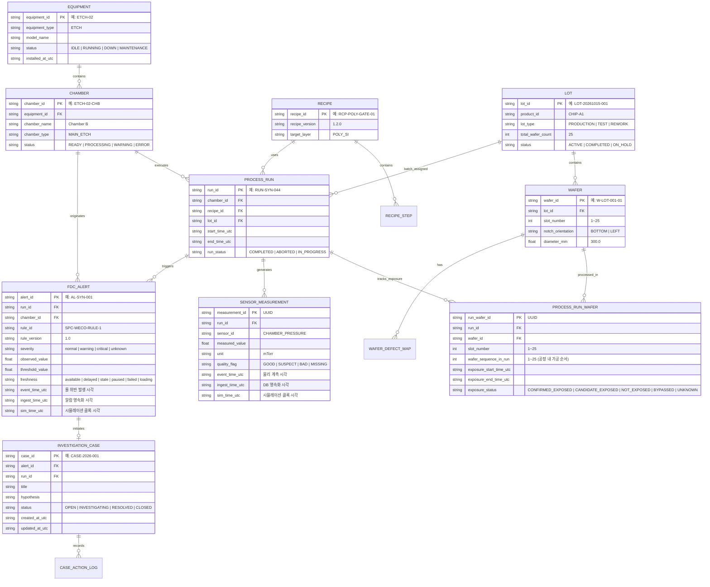

# FAB ONE — 반도체 도메인 데이터 계약 및 공학 계산 명세서 v0.2

- **문서 ID:** ARCH-DOC-002
- **상태:** PROPOSED (A01 기획자 및 프로젝트 오너 승인 대기)
- **개정 이력:** v0.2 (2026-10-15, A01 리뷰 #6184247949 및 Codex P0/P1 검토의견 반영 — Cpk/Ppk 추정량 분리, Wafer-Run 노출 계보 모델 추가, 3대 타임스탬프 영속화, 결측/지연 상호배타성 확립, 임의 임계값 단정 배제)
- **작성자:** A02 (수석 소프트웨어 개발 에이전트)
- **관련 Issue / PR:** Issue [#1](https://github.com/Junebooky/semi_fab/issues/1), Issue [#8](https://github.com/Junebooky/semi_fab/issues/8), Draft PR [#2](https://github.com/Junebooky/semi_fab/pull/2), QA PR [#3](https://github.com/Junebooky/semi_fab/pull/3), Design PR [#7](https://github.com/Junebooky/semi_fab/pull/7), PR [#10](https://github.com/Junebooky/semi_fab/pull/10)

---

## 1. 개요 및 설계 목적

본 문서는 반도체 제조 공정(특히 식각/Etch 공정) 및 설비 시뮬레이션에 필요한 **핵심 도메인 엔티티 관계, 스키마, 식별자 체계, 시간 및 단위 규약, 그리고 공학 계산 공식(수율, 식각률, 공정능력지수/공정성능지수)**의 기술 표준을 정의한다.

A01 검토 의견(#6184247949) 및 A04 QA 사전 지적사항(QA-F05, QA-F06)을 충실히 반영하여:
1. **$C_p / C_{pk}$ (군내 변동 기반)와 $P_p / P_{pk}$ (전체 변동 기반)의 엄격한 분리 및 추정량 명시**,
2. **단일 웨이퍼 공정 특성을 반영한 Wafer-Run 노출 계보 모델(`PROCESS_RUN_WAFER`) 수립**,
3. **사건 시각(`event_time`), 수집 시각(`ingest_time`), 가상 시각(`sim_time`)의 물리적 영속화**,
4. **품질 플래그(`quality_flag`)와 스트림 신선도(`freshness`)의 상호 배타적·독립적 축 설계**,
5. **공학적 단정 표현(임의 임계값의 보편성 주장, 자동 결함/고장 단정) 배제**를 구현한다.

---

## 2. 도메인 엔티티 관계 모델 (ERD)



---

## 3. 식별자, 데이터 모델 및 Wafer-Run 노출 계보

### 3.1 식별자 명명 규칙
- 모든 기본 키(PK)는 고유하며 시스템 전역에서 유일하다.
- 합성 데이터 식별자는 실제 FAB과의 혼동을 방지하기 위해 접두사 또는 접미사에 `SYN`을 포함할 수 있다. (예: `RUN-SYN-044`, `AL-SYN-001`)

### 3.2 외래키 무결성 및 삭제 정책 (Cascading Policy)
- **`ON DELETE RESTRICT` (기본 원칙):** 설비, 챔버, 레시피, 로트, 공정 실행 레코드는 하위 계측치, 알람 또는 조사 케이스가 존재하는 경우 물리적 삭제가 원천 차단된다.
- **`ON UPDATE CASCADE`:** 코드 변경 시 참조 테이블에 자동 전파된다.

### 3.3 Wafer $\to$ Run 노출 계보 및 Lot/Wafer 상태 구분 (P0-4 대응)
- **도메인 문제 인식:** 식각 챔버(Etch Chamber)는 통상 단일 웨이퍼 가공(Single-wafer processing) 방식으로 운영된다. 하나의 Lot(최대 25매)이 `PROCESS_RUN`에 할당되었다고 해서, 특정 챔버 이상 발생 시점에 모든 25매가 동일하게 노출된 것은 아니다.
- **`PROCESS_RUN_WAFER` 매핑 엔티티 도입:**
  - 챔버 내 웨이퍼 투입 순서(`wafer_sequence_in_run`), 실제 가공 시작/종료 시각(`exposure_start_time_utc`, `exposure_end_time_utc`)을 개별 웨이퍼 단위로 추적한다.
  - **노출 상태 (`exposure_status`) 분류:**
    - `CONFIRMED_EXPOSED`: 알람 발생 시간 윈도우에 해당 챔버 내에서 가공 중이었음이 시간적으로 입증된 웨이퍼.
    - `CANDIDATE_EXPOSED`: 동일 Lot 소속이며 가공 대기 또는 인접 시간대에 투입되어 잠재적 영향 가능성이 있는 후보 웨이퍼.
    - `NOT_EXPOSED`: 해당 챔버에 투입되지 않았거나 이상 발생 이전에 공정이 완료된 웨이퍼.
    - `BYPASSED`: 더미(Dummy)/테스트 웨이퍼 또는 레시피에 의해 해당 스텝을 건너뛴 웨이퍼.
    - `UNKNOWN`: 이력 추적 정보 불충분.
- **UI 및 통계 가드레일:**
  - 화면상에서 특정 챔버의 이상 알람을 이유로 "해당 Lot 전체 25매 결함 확정"으로 표기하는 것을 엄격히 금지한다.
  - A03 대시보드에서는 반드시 **'영향 가능 후보 Lot/Wafer (Candidate Exposed)'**로 명시하고, 엔지니어의 추가 조사 워크플로를 통해서만 검증 상태로 전이시킨다.

---

## 4. 시간 축, 타임존 및 지연 감지 규약

### 4.1 3대 시간 축의 분리 및 영속화 (P1-6 대응)
본 아키텍처는 측정치 및 알람 테이블에 다음 3가지 시간 필드를 각각 독립된 컬럼으로 영속화한다:

1. **사건 발생 시각 (`event_time_utc`):** 센서에서 물리적 측정치가 생성되거나 FDC 룰 위반 조건이 충족된 시점.
2. **수집 영속 시각 (`ingest_time_utc`):** 수집 파이프라인 또는 백엔드가 해당 데이터를 DB에 기록한 시스템 시점.
3. **가상 시뮬레이션 시각 (`sim_time_utc`):** 시뮬레이터 내부 가상 클록의 시점.

- **파생 공학 지표:**
  - **수집 지연 시간 (Ingestion Latency):** $\Delta t_{\text{ingest}} = \text{ingest\_time\_utc} - \text{event\_time\_utc}$
  - **시뮬레이션 지연 (Simulation Lag):** $\Delta t_{\text{sim}} = \text{sim\_time\_utc} - \text{event\_time\_utc}$

### 4.2 타임존 저장 및 표기 원칙
- **스토리지 및 API 통신:** **엄격한 ISO 8601 UTC** (`YYYY-MM-DDTHH:MM:SS.sssZ`) 문자열만 허용한다.
- **UI 표기:** A03 디자인 명세에 따라 기본 표시는 **한국 표준시 (`Asia/Seoul`, KST, UTC+09:00)**를 적용하며, 반드시 `KST` 접미사를 병기한다. (예: `2026-10-15 10:24:03 KST`)

### 4.3 품질 플래그(Quality)와 스트림 신선도(Freshness)의 상호 배타적 설계 (P1-6 대응)
`quality_flag`는 **개별 데이터 포인트의 유효성**을 나타내는 속성이며, `freshness`는 **스트림 전체의 최신성**을 나타내는 챔버/센서 레벨의 상태다. 두 축은 독립적으로 평가된다.

#### 1) 개별 샘플 품질 플래그 (`quality_flag`, Per-Sample Attribute)
- `GOOD`: 정상 계측치.
- `SUSPECT`: 노이즈 의심, 일시적 튐(Spike), 또는 박막 두께 역전 등 이상 징후.
- `BAD`: 센서 포화(Saturation), 통신 에러 코드가 수신된 비정상치.
- `MISSING`: 샘플 주기 내에 데이터가 도착하지 않아 `value = null`로 기록된 상태.
  > **절대 금지:** 결측값(`MISSING`, `null`)을 숫자 `0`으로 치환하여 저장하거나 차트에 렌더링하지 않는다. 차트 상에서 결측 구간은 선을 단절(Discontinuous)시키고 회색 음영으로 명시한다.

#### 2) 스트림 신선도 (`freshness`, Stream-Level State at evaluation time $T_{\text{sim}}$)
샘플링 주기 $\Delta t$와 마지막 정상 수신 시각 $T_{\text{last\_good}}$ 간의 경과 시간 $\tau = T_{\text{sim}} - T_{\text{last\_good}}$를 기준으로 상호 배타적(Mutually Exclusive)으로 판정한다:

| 상태 코드 | 판정 조건 (시나리오 설정 정책 기준) | 의미 및 UI 처리 |
|---|---|---|
| `paused` | 시뮬레이터 클록 정지 상태 | 일시정지 아이콘, 시계 정지 배지 (최우선) |
| `failed` | 수집 파이프라인 통신 에러 발생 | 적색 연결 단절 아이콘 + 재시도 버튼 |
| `loading` | 최초 데이터 스트림 연결 대기 | 스켈레톤 UI 노출 |
| `stale` | $\tau > 3.0 \times \Delta t$ | 스트림 단절 경고 ('데이터 수집 중단') |
| `delayed` | $1.0 \times \Delta t < \tau \le 3.0 \times \Delta t$ | 황색 시계 아이콘 ('마지막 수집: X초 전') |
| `available` | $0 \le \tau \le 1.0 \times \Delta t$ | 정상 녹색 배지 ('정상 수집 중') |

- **상태 평가 우선순위:** `paused` $>$ `failed` $>$ `loading` $>$ `stale` $>$ `delayed` $>$ `available`

---

## 5. 공학 물리량 단위 및 허용 오차 규약

모든 센서 및 계측 데이터는 표준 SI 단위 또는 반도체 업계 표준 공학 단위를 사용하며, 단위 표기를 누락할 수 없다.

| 공학 파라미터 | 기본 단위 기호 | 단위 영문명 | 시나리오 기준 일반 관찰 범위 | 허용 정밀도 (소수점) |
|---|---|---|---|---|
| 챔버 압력 (Pressure) | `mTorr` | milli-Torr | `0.1 ~ 500.0` (시나리오 정책) | 소수점 2자리 |
| 소스 RF 전력 (RF Power) | `W` | Watt | `0 ~ 3000` (시나리오 정책) | 소수점 0자리 (정수) |
| 바이어스 전력 (Bias Power) | `W` | Watt | `0 ~ 1500` (시나리오 정책) | 소수점 0자리 (정수) |
| 가스 유량 (Gas Flow) | `sccm` | Standard Cubic Centimeters per Minute | `0.0 ~ 1000.0` (시나리오 정책) | 소수점 1자리 |
| 척 온도 (Chuck Temp) | `°C` | Celsius | `-20.0 ~ 120.0` (시나리오 정책) | 소수점 1자리 |
| 식각 속도 (Etch Rate) | `nm/min` | nanometers per minute | 음수 가능 (두께 증가 관측 시) | 소수점 1자리 |
| 박막 두께 (Thickness) | `nm` | nanometer | `1.0 ~ 5000.0` (시나리오 정책) | 소수점 1자리 |
| 다이 수율 (Die Yield) | `%` | Percentage | `0.00 ~ 100.00` | 소수점 2자리 |
| $C_p, C_{pk}, P_p, P_{pk}$ | (무차원) | Dimensionless | **제한 없음** (음수 가능, 상한 무제한) | 소수점 3자리 |

> **주의 (P1-5 반영):** 위 표의 관찰 범위는 시연 시나리오의 기준값일 뿐, 자연 법칙이 아니다. 특히 $C_{pk}$ 및 $P_{pk}$는 공정 평균이 규격을 이탈하면 음수가 될 수 있으며, 산포가 극히 작으면 5.0을 초과할 수 있다. `0.0 ~ 5.0`으로 인위적으로 값을 자르거나(clamp) 에러 처리하지 않는다.

---

## 6. 공학 지표 공식 및 계산 명세 (P0-1, P1-5, P1-7 반영)

### 6.1 다이 수율 (Die Yield)

#### 공식
$$\text{Die Yield (\%)} = \left( \frac{N_{\text{good}}}{N_{\text{eligible}}} \right) \times 100$$

#### 변수 정의 및 경계 조건
- $N_{\text{good}}$: 전기적/광학적 검사를 통과한 정상 다이 수 (정수, $N_{\text{good}} \ge 0$).
- $N_{\text{eligible}}$: 판정 대상 다이 수 (정수, $N_{\text{eligible}} > 0$).
- **에지 다이 제외 정책 (시나리오 설정):** 웨이퍼 외곽 가장자리 비완전 다이 및 검사 제외 영역(Edge Exclusion, 기본 설정: 3mm)에 위치한 다이는 $N_{\text{eligible}}$ 분모에서 제외한다. 본 제외 폭은 시나리오/레시피 설정에 의해 변경될 수 있다.
- **예외 처리 및 유효성 검증:**
  - $N_{\text{eligible}} = 0$: 계산 불가 (`NaN` 또는 `DIV_BY_ZERO` 에러 코드 반환).
  - $N_{\text{good}} > N_{\text{eligible}}$: 데이터 무결성 위반 (`DATA_INTEGRITY_ERROR`).
  - $N_{\text{good}} < 0$ 또는 $N_{\text{eligible}} < 0$: 입력 오류 (`INVALID_COUNT`).

---

### 6.2 식각 속도 (Etch Rate) (P1-7 반영)

#### 공식
$$\text{Etch Rate (nm/min)} = \frac{T_{\text{before}} - T_{\text{after}}}{\Delta t}$$

#### 변수 정의 및 경계 조건
- $T_{\text{before}}$: 식각 전 박막 두께 (`nm`, $T_{\text{before}} > 0$).
- $T_{\text{after}}$: 식각 후 박막 두께 (`nm`, $T_{\text{after}} \ge 0$).
- $\Delta t$: 순수 플라즈마 식각 시간 (`min`, $\Delta t > 0$). 초 단위 입력 시 $\Delta t = t_{\text{sec}} / 60.0$.
- **부호 및 비정상 상태 처리 규약:**
  - 정상 식각: $T_{\text{before}} > T_{\text{after}} \implies \text{Etch Rate} > 0$.
  - **박막 두께 증가 ($T_{\text{before}} < T_{\text{after}} \implies \text{Etch Rate} < 0$):**
    - 계산된 음수값은 그대로 유지한다. (절댓값 변환 금지).
    - 상태 플래그를 `SUSPECT_THICKNESS_INCREASE`로 지정하고 "박막 두께 증가 관측 — 증착 가능성 또는 계측 오차 의심" 문구를 UI에 표시한다.
    - **단정 금지:** 두께 증가를 특정 물리적 증착(Deposition)이나 계측기 고장으로 자동 확정하지 않으며, 승인된 FDC 룰에 등록되어 있지 않은 이상 임의로 FDC 알람을 자동 발행하지 않는다.
  - $\Delta t \le 0$: `INVALID_PROCESS_TIME` 예외 반환.

---

### 6.3 공정능력지수($C_p, C_{pk}$) vs 공정성능지수($P_p, P_{pk}$) (P0-1 대응)

제조 품질 공학(AIAG SPC 매뉴얼, ISO 21747, NIST/SEMATECH e-Handbook §1.6) 표준에 따라, 사용되는 변동 추정량에 따라 지표를 명확히 분리하여 명명한다.

#### 1) 공정성능지수 ($P_p, P_{pk}$ — 전체 변동 기준, Overall Variation)
단일 배치 또는 부분군 구분이 없는 전체 샘플 데이터의 **표본 표준편차 ($s$)**를 분모로 사용한다.

$$s = \sqrt{\frac{1}{n - 1} \sum_{i=1}^n (x_i - \bar{x})^2}$$

$$P_p = \frac{\text{USL} - \text{LSL}}{6s}$$

$$P_{pk} = \min\left( \frac{\text{USL} - \bar{x}}{3s}, \frac{\bar{x} - \text{LSL}}{3s} \right)$$

- **용도:** 초기 샘플, 공정이 통계적 관리 상태에 있는지 확인되기 전, 또는 장기 전체 변동 평가 시 사용.

#### 2) 공정능력지수 ($C_p, C_{pk}$ — 군내 변동 기준, Within-Subgroup Variation)
합리적 부분군(Rational Subgroups)으로 수집된 데이터에서 **공정이 통계적 관리 상태(In Statistical Control)**에 있음을 전제로, 군내 변동 추정량($\hat{\sigma}_{\text{within}}$)을 분모로 사용한다.

$$\hat{\sigma}_{\text{within}} = \frac{\bar{R}}{d_2} \quad \text{또는} \quad \frac{\bar{s}}{c_4}$$

$$C_p = \frac{\text{USL} - \text{LSL}}{6\hat{\sigma}_{\text{within}}}$$

$$C_{pk} = \min\left( \frac{\text{USL} - \bar{x}}{3\hat{\sigma}_{\text{within}}}, \frac{\bar{x} - \text{LSL}}{3\hat{\sigma}_{\text{within}}} \right)$$

- **용도:** 공정 고유의 단기 잠재 능력을 평가할 때 사용.

#### 3) EKL, API, 화면 및 테스트 표기 규약 (P0-1 핵심 요구사항)
- 단일 표준편차 $s$를 사용하면서 이를 무조건 보편적 $C_{pk}$라고 부르는 행위를 금지한다.
- **API 및 EKL 데이터 계약:**
  - `capabilityType`: `"WITHIN_SUBGROUP_CAPABILITY"` ($C_p/C_{pk}$) | `"OVERALL_PERFORMANCE"` ($P_p/P_{pk}$)
  - `sigmaEstimator`: `"SAMPLE_STD_S"` ($s$) | `"R_BAR_OVER_D2"` ($\bar{R}/d_2$) | `"S_BAR_OVER_C4"` ($\bar{s}/c_4$)
- **화면 UI 가이드:** 화면 라벨에 단순히 $C_{pk}$만 적지 않고, 툴팁 및 상세 패널에 **"Ppk (전체 표본 s 기반, 장기 성능)"** 또는 **"Cpk (부분군 R-bar/d2 기반, 단기 능력)"**임을 명확히 구분하여 표기한다.

#### 4) 통계적 유효성 및 경계 조건 (P1-5 반영)
- **평가 불가 (`EVALUATION_INVALID`):**
  - $n < 2$: 표본 표준편차 계산 불가.
  - $\hat{\sigma} = 0$: 분산 0으로 인한 `ZERO_VARIANCE_ERROR`.
  - USL 및 LSL이 모두 누락된 경우.
- **신뢰도 경고 (`ASSUMPTION_WARNING`):**
  - 표본수 $n < 30$: 통계적 신뢰도 경고 (`SAMPLE_SIZE_BELOW_RECOMMENDED_30`). 계산값은 정상 산출하되 경고 플래그를 함께 전달한다. (단, $n \ge 30$을 보편적 물리 법칙으로 주장하지 않음).
  - 정규성 검정(Shapiro-Wilk 등) 미충족 시 `NON_NORMAL_DISTRIBUTION_WARNING`.
- **음수 및 극단값:**
  - 공정 평균이 규격 한계를 벗어나는 경우 $C_{pk} < 0$, $P_{pk} < 0$이 정상적으로 산출되며 이를 0으로 자르지 않는다.
  - 산포가 극히 작아 $C_{pk} > 5.0$인 경우도 정상 산출한다.

---

### 6.4 설비 가동률 (Equipment Operational Availability)

$$\text{Availability (\%)} = \left( \frac{t_{\text{operating}}}{t_{\text{operating}} + t_{\text{downtime}}} \right) \times 100$$

- 본 지표는 단순 시간 가동률이며, 속도 손실 및 양품 수율을 결합한 종합설비효율(OEE)과 혼용하지 않는다.

---

## 7. A03 디자인 명세 및 자산 ID 연동 (P1-8 반영)

A03의 공식 디자인 토큰(PR #7, `docs/design/tokens/fab-one.tokens.json`)과 완전히 일치하도록 자산 ID를 동기화한다:

- **웨이퍼 3D 클레이 플레이스홀더 슬롯:** `illustration.wafer.v1`
- **식각 챔버 3D 클레이 플레이스홀더 슬롯:** `illustration.etch-chamber.v1`
- **엔지니어링 가드레일:** 이미지 지연 로딩 시 레이아웃 시프트(CLS)를 방지하기 위해 CSS `aspect-ratio: 1/1` 및 `object-fit: contain`을 적용한다.

---

## 8. TypeScript 데이터 인터페이스

```typescript
export type SeverityLevel = "normal" | "warning" | "critical" | "unknown";
export type FreshnessStatus = "available" | "delayed" | "stale" | "paused" | "failed" | "loading";
export type SampleQuality = "GOOD" | "SUSPECT" | "BAD" | "MISSING";
export type DataOrigin = "synthetic" | "public_research" | "live";
export type ExposureStatus = "CONFIRMED_EXPOSED" | "CANDIDATE_EXPOSED" | "NOT_EXPOSED" | "BYPASSED" | "UNKNOWN";
export type CapabilityType = "WITHIN_SUBGROUP_CAPABILITY" | "OVERALL_PERFORMANCE";
export type SigmaEstimator = "SAMPLE_STD_S" | "R_BAR_OVER_D2" | "S_BAR_OVER_C4";

export interface SensorSample {
  measurementId: string;
  runId: string;
  sensorId: string;
  value: number | null;
  unit: string;
  quality: SampleQuality;
  eventTimeUtc: string; // ISO 8601 UTC
  ingestTimeUtc: string; // ISO 8601 UTC
  simTimeUtc: string; // ISO 8601 UTC
}

export interface ProcessRunWafer {
  runWaferId: string;
  runId: string;
  waferId: string;
  lotId: string;
  slotNumber: number;
  waferSequenceInRun: number;
  exposureStartTimeUtc: string;
  exposureEndTimeUtc: string;
  exposureStatus: ExposureStatus;
}

export interface CapabilityResult {
  metricType: CapabilityType;
  estimator: SigmaEstimator;
  indexP: number | null; // Cp or Pp
  indexPk: number | null; // Cpk or Ppk
  sampleMean: number;
  sigmaEstimate: number;
  sampleCount: number;
  status: "OK" | "ASSUMPTION_WARNING" | "EVALUATION_INVALID";
  warningMessage?: string;
}

export interface FdcAlertItem {
  alertId: string;
  runId: string;
  chamberId: string;
  equipmentId: string;
  parameterName: string;
  unit: string;
  observedValue: number;
  thresholdValue: number;
  severity: SeverityLevel;
  freshness: FreshnessStatus;
  dataOrigin: DataOrigin;
  eventTimeUtc: string;
  ingestTimeUtc: string;
  simTimeUtc: string;
  ruleDescription: string;
}
```
