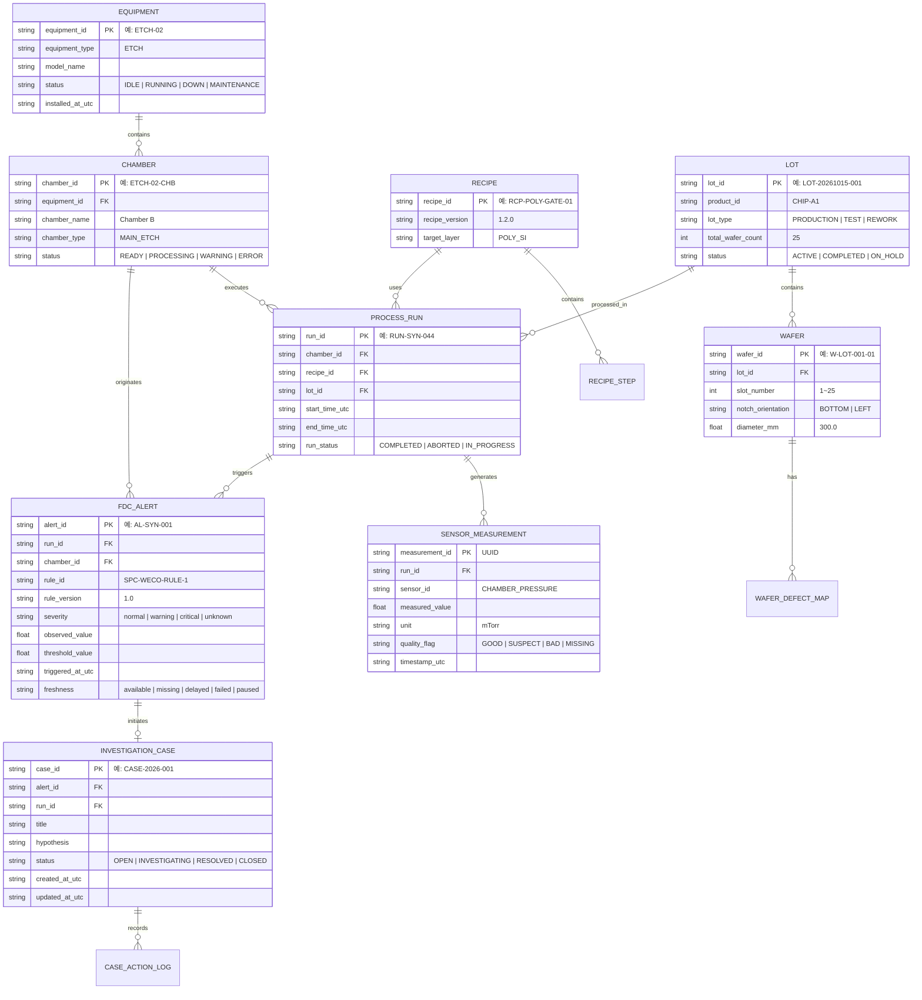

# FAB ONE — 반도체 도메인 데이터 계약 및 공학 계산 명세서 v0.1

- **문서 ID:** ARCH-DOC-002
- **상태:** PROPOSED (A01 기획자 및 프로젝트 오너 승인 대기)
- **작성자:** A02 (수석 소프트웨어 개발 에이전트)
- **관련 Issue / PR:** Issue [#1](https://github.com/Junebooky/semi_fab/issues/1), Issue [#8](https://github.com/Junebooky/semi_fab/issues/8), Draft PR [#2](https://github.com/Junebooky/semi_fab/pull/2), QA PR [#3](https://github.com/Junebooky/semi_fab/pull/3), Design PR [#7](https://github.com/Junebooky/semi_fab/pull/7)
- **일자:** 2026-10-15

---

## 1. 개요 및 설계 목적

본 문서는 반도체 제조 공정(특히 식각/Etch 공정) 및 설비 시뮬레이션에 필요한 **핵심 도메인 엔티티 관계, 스키마, 식별자 체계, 시간 및 단위 규약, 그리고 공학 계산 공식(수율, 식각률, 공정능력지수)**의 기술 표준을 정의한다.

A04 QA의 사전 지적사항인 **QA-F05(인과관계 단정 표현 금지)** 및 **QA-F06(수식 추정량·분모·단위·경계값 계약 공백)**을 해소하고, A03 디자인 명세(PR #7)의 UI 컴포넌트와 백엔드 간의 데이터 정합성을 보장하는 것을 목표로 한다.

---

## 2. 도메인 엔티티 관계 모델 (ERD)



---

## 3. 식별자, 데이터 타입 및 제약조건 규약

### 3.1 식별자 명명 규칙
- 모든 기본 키(PK)는 고유하며 시스템 전역에서 유일하다.
- 합성 데이터 식별자는 실제 FAB과의 혼동을 방지하기 위해 접두사 또는 접미사에 `SYN`을 포함할 수 있다. (예: `RUN-SYN-044`, `AL-SYN-001`)

### 3.2 외래키 무결성 및 삭제 정책 (Cascading Policy)
반도체 이력 추적성(Traceability)과 감사 기록의 특성상 과거의 실행 이력과 측정치는 임의로 삭제되어서는 안 된다.
- **`ON DELETE RESTRICT` (기본 정책):** 설비, 챔버, 레시피, 로트, 공정 실행 레코드는 하위 계측치나 알람이 존재하는 경우 삭제를 원천 차단한다.
- **`ON UPDATE CASCADE`:** 마스터 데이터 코드 변경 시 참조 테이블에 자동 반영된다.

---

## 4. 시간 축, 타임존 및 지연 감지 규약

### 4.1 3대 시간 축 정의
1. **사건 발생 시각 (`event_time_utc`):** 센서에서 물리적 측정치가 생성되거나 FDC 규칙 위반이 발생한 실제/가상 시점.
2. **수집 기록 시각 (`ingest_time_utc`):** 데이터 수집 파이프라인 또는 시뮬레이터 큐가 해당 레코드를 수신하여 DB에 영속화한 시점.
3. **가상 시뮬레이션 시각 (`sim_time_utc`):** 시뮬레이터 내부 가상 클록의 현재 시점.
   - 관계식: $\text{Latency} = \text{ingest\_time\_utc} - \text{event\_time\_utc}$

### 4.2 타임존 저장 및 표기 원칙
- **스토리지 및 API 전송:** **엄격한 ISO 8601 UTC** (`YYYY-MM-DDTHH:MM:SS.sssZ`) 문자열만 허용한다. 로컬 타임존 오프셋이 포함된 시간 문자열을 DB에 저장하지 않는다.
- **UI 표기:** A03 디자인 명세에 따라 기본 표시 타임존은 **한국 표준시 (`Asia/Seoul`, KST, UTC+09:00)**를 적용하며, 반드시 `KST` 접미사를 병기한다. (예: `2026-10-15 10:24:03 KST`)

### 4.3 데이터 수집 지연(Delayed) 및 결측(Missing) 판정 로직
- **정상 (`available`):** $\text{sim\_time\_utc} - \text{last\_good\_sample\_timestamp} \le 1.5 \times \text{sampling\_interval}$
- **수집 지연 (`delayed`):** $1.5 \times \text{sampling\_interval} < \text{sim\_time\_utc} - \text{last\_good\_sample\_timestamp} \le 5.0 \times \text{sampling\_interval}$
- **데이터 결측 (`missing`):** 샘플 수집 주기에 데이터가 도착하지 않았거나 null로 기록된 경우.
  > **절대 금지:** 결측값(Missing/Null)을 숫자 `0`으로 대체하여 렌더링하거나 계산에 포함하지 않는다. 차트 상에서 결측 구간은 선을 단절(Discontinuous)시키고 회색 음영으로 명시한다.

---

## 5. 공학 물리량 단위 및 허용 오차 규약

모든 센서 및 계측 데이터는 표준 SI 단위 또는 반도체 업계 표준 공학 단위를 사용하며, 단위 표기를 누락할 수 없다.

| 공학 파라미터 | 기본 단위 기호 | 단위 영문명 | 유효 범위 (식각 공정) | 허용 정밀도 (소수점) |
|---|---|---|---|---|
| 챔버 압력 (Pressure) | `mTorr` | milli-Torr | `0.1 ~ 500.0` | 소수점 2자리 |
| 소스 RF 전력 (RF Power) | `W` | Watt | `0 ~ 3000` | 소수점 0자리 (정수) |
| 바이어스 전력 (Bias Power) | `W` | Watt | `0 ~ 1500` | 소수점 0자리 (정수) |
| 가스 유량 (Gas Flow) | `sccm` | Standard Cubic Centimeters per Minute | `0.0 ~ 1000.0` | 소수점 1자리 |
| 척 온도 (Chuck Temp) | `°C` | Celsius | `-20.0 ~ 120.0` | 소수점 1자리 |
| 식각 속도 (Etch Rate) | `nm/min` | nanometers per minute | `10.0 ~ 2000.0` | 소수점 1자리 |
| 박막 두께 (Thickness) | `nm` | nanometer | `1.0 ~ 5000.0` | 소수점 1자리 |
| 다이 수율 (Die Yield) | `%` | Percentage | `0.00 ~ 100.00` | 소수점 2자리 |
| 공정능력지수 (Cp, Cpk) | (무차원) | Dimensionless | `0.000 ~ 5.000` | 소수점 3자리 |

---

## 6. 공학 지표 공식 및 계산 명세 (QA-F06 해소)

### 6.1 다이 수율 (Die Yield)

#### 공식
$$\text{Die Yield (\%)} = \left( \frac{N_{\text{good}}}{N_{\text{eligible}}} \right) \times 100$$

#### 변수 정의 및 경계 조건
- $N_{\text{good}}$: 전기적/광학적 검사를 통과한 정상 다이 수 (정수, $N_{\text{good}} \ge 0$).
- $N_{\text{eligible}}$: 판정 대상 다이 수 (정수, $N_{\text{eligible}} > 0$).
- **제외 대상 다이 ($N_{\text{excluded}}$):** 웨이퍼 가장자리 비완전 다이(Edge Incomplete Dies) 및 검사 제외 영역(Edge Exclusion, 통상 3mm)에 위치한 다이는 $N_{\text{eligible}}$ 분모에서 제외한다.
- **예외 처리 및 유효성 검증:**
  - $N_{\text{eligible}} = 0$인 경우: 계산 불가, `NaN` 또는 `DIV_BY_ZERO` 에러 코드를 반환하며 수율 0%로 왜곡하지 않는다.
  - $N_{\text{good}} > N_{\text{eligible}}$인 경우: 데이터 무결성 위반 (`DATA_INTEGRITY_ERROR`).
  - $N_{\text{good}} < 0$ 또는 $N_{\text{eligible}} < 0$인 경우: 입력 오류 (`INVALID_COUNT`).

---

### 6.2 식각 속도 (Etch Rate)

#### 공식
$$\text{Etch Rate (nm/min)} = \frac{T_{\text{before}} - T_{\text{after}}}{\Delta t}$$

#### 변수 정의 및 경계 조건
- $T_{\text{before}}$: 식각 전 박막 두께 (`nm`, $T_{\text{before}} > 0$).
- $T_{\text{after}}$: 식각 후 박막 두께 (`nm`, $T_{\text{after}} \ge 0$).
- $\Delta t$: 순수 플라즈마 식각 시간 (`min`, $\Delta t > 0$). 초(`sec`) 단위 입력 시 $\Delta t = t_{\text{sec}} / 60.0$으로 변환.
- **부호 및 비정상 상태 처리 규약 (A04 지적사항 반영):**
  - 정상 식각: $T_{\text{before}} > T_{\text{after}} \implies \text{Etch Rate} > 0$.
  - 두께 증가 ($T_{\text{before}} < T_{\text{after}}$):
    - 식각 공정에서는 물리적으로 불가능하거나 폴리머 재증착(Deposition) 또는 계측기 영점 오류를 의미함.
    - 음수 식각률을 절댓값으로 강제 변환하여 정상 식각률처럼 보여주지 않는다.
    - 상태 플래그를 `SUSPECT_DEPOSITION_OR_MEASUREMENT_ERROR`로 지정하고 알람 이벤트를 생성한다.
  - $\Delta t \le 0$: `INVALID_PROCESS_TIME` 예외 반환.

---

### 6.3 공정능력지수 (Cp, Cpk) 및 관리한계 vs 규격한계 (QA-F05, QA-F06 대응)

#### 엄격한 한계선 구분
- **규격한계 (Specification Limits, USL / LSL):** 제품 설계자가 요구하는 엔지니어링 허용 공차 한계. 불량 판정의 기준.
- **관리한계 (Control Limits, UCL / LCL / CL):** 공정 데이터의 통계적 변동($\mu \pm 3\sigma$)에 의해 계산된 자연적 변동 범위. 이상 원인 탐지(SPC)의 기준.
  > **원칙 (QA-F05 반영):** 관리한계를 벗어난 경고(Outlier/Alarm)는 **"원인 조사를 시작할 근거가 됨을 의미할 뿐, 해당 로트나 웨이퍼의 물리적 결함 또는 폐기를 확정하는 인과관계를 의미하지 않는다."**

#### 공식 및 통계적 추정량(Estimator) 명시
$$\text{Process Mean } \bar{x} = \frac{1}{n} \sum_{i=1}^n x_i$$

$$C_p = \frac{\text{USL} - \text{LSL}}{6\hat{\sigma}}$$

$$C_{pk} = \min\left( \frac{\text{USL} - \bar{x}}{3\hat{\sigma}}, \frac{\bar{x} - \text{LSL}}{3\hat{\sigma}} \right)$$

- **표준편차 추정량 ($\hat{\sigma}$):**
  - **전체 표준편차 (Overall Sample Standard Deviation, $s$):**
    $$s = \sqrt{\frac{1}{n - 1} \sum_{i=1}^n (x_i - \bar{x})^2}$$
    (초기 MVP의 단일 배치 공정능력 분석 표준으로 채택)
  - **군내 변동 추정량 (Within-Subgroup, $\bar{R}/d_2$ 또는 $\bar{s}/c_4$):** 부분군 기반 관리도 구현 시 명시적으로 분리 적용.
- **적용 전제 조건 및 가드레일:**
  1. 샘플 수: 최소 $n \ge 30$을 충족해야 공학적으로 유효한 $C_{pk}$ 지표로 인정한다. ($n < 30$일 경우 `INSUFFICIENT_SAMPLE_SIZE` 경고 표시).
  2. 분산이 $0$ ($\hat{\sigma} = 0$)인 경우: 계산 불가, `ZERO_VARIANCE` 에러 처리.
  3. 편측 규격(One-Sided Spec)인 경우: 규격이 존재하는 쪽의 $C_{pu}$ 또는 $C_{pl}$ 단일값만 계산하여 제공.

---

### 6.4 설비 가동률 (Equipment Operational Availability)

#### 공식
$$\text{Availability (\%)} = \left( \frac{t_{\text{operating}}}{t_{\text{operating}} + t_{\text{downtime}}} \right) \times 100$$

- $t_{\text{operating}}$: 공정 처리 및 대기 시간.
- $t_{\text{downtime}}$: 고장 정지(Unscheduled Down) 및 계획 정비(Scheduled Maintenance) 시간.
- **주의:** 본 지표는 단순 시간 가동률이며, 속도 손실 및 양품 수율을 결합한 종합설비효율(OEE)과 혼용하지 않는다.

---

## 7. 데이터 출처(Provenance) 및 합성 라벨링 규약

모든 데이터 레코드는 다음 3가지 메타데이터를 필수적으로 포함한다:
1. `source_kind`: `"synthetic"` | `"public_research"` | `"live"` (MVP에서는 100% `"synthetic"`으로 고정).
2. `scenario_id`: 해당 데이터를 생성한 시뮬레이션 시나리오 ID (예: `"ETH-SYN-01"`).
3. `fixture_hash`: 데이터 생성의 기준이 된 원본 파라미터 파일의 SHA-256 해시값.

UI에서는 모든 화면 상단 및 차트 캡션에 **`[SIMULATION · 합성 데이터]`** 배지를 상시 표시한다.

---

## 8. TypeScript 데이터 인터페이스 (A03 UI 연동용)

```typescript
export type SeverityLevel = "normal" | "warning" | "critical" | "unknown";
export type FreshnessStatus = "available" | "missing" | "delayed" | "failed" | "paused" | "loading";
export type DataOrigin = "synthetic" | "public_research" | "live";

export interface SensorSample {
  timestamp: string; // ISO 8601 UTC
  value: number | null;
  quality: "GOOD" | "SUSPECT" | "BAD" | "MISSING";
}

export interface ControlLimits {
  centerLine: number;
  upperControlLimit: number;
  lowerControlLimit: number;
  calculatedAt: string;
  subgroupSize?: number;
}

export interface SpecificationLimits {
  target: number;
  upperSpecLimit: number;
  lowerSpecLimit: number;
  unit: string;
}

export interface FdcAlertItem {
  alertId: string;
  runId: string;
  chamberId: string;
  equipmentId: string;
  parameterName: string;
  unit: string;
  observedValue: number;
  severity: SeverityLevel;
  freshness: FreshnessStatus;
  dataOrigin: DataOrigin;
  triggeredAt: string; // ISO 8601 UTC
  ruleDescription: string;
}
```

---

## 9. A01 기획자 결정 필요 항목 (Decisions Pending A01)

1. **[A01 결정 필요 2-1] 공정능력지수(Cpk) 표준편차 추정량 공식 채택:**
   - [ ] 안 1 (권장): 표본 표준편차 ($s$, $n-1$ 자유도) 단일 적용 및 EKL에 명시
   - [ ] 안 2: 부분군 범위 기반 추정량 ($\bar{R}/d_2$) 적용 (부분군 크기 $k$ 정의 필요)
2. **[A01 결정 필요 2-2] 식각률 음수(두께 증가) 발생 시 처리 정책:**
   - [ ] 안 1 (권장): `SUSPECT_DEPOSITION_OR_MEASUREMENT_ERROR` 경고 생성 및 음수값 그대로 표시
   - [ ] 안 2: 계산 에러(`ERR_NEGATIVE_ETCH_RATE`)로 간주하고 차트에 결측 표시
3. **[A01 결정 필요 2-3] 다이 수율의 에지 다이(Edge Die) 제외 폭:**
   - [ ] 안 1 (권장): 웨이퍼 외곽 3mm 고정 제외 (300mm 웨이퍼 기준)
   - [ ] 안 2: 레시피별로 에지 제외 영역 가변 설정
