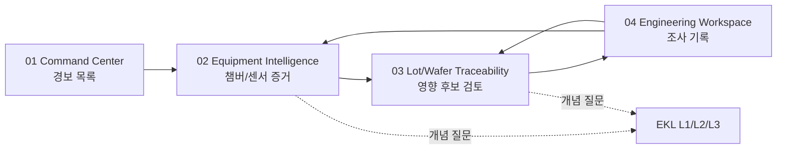

# Etch Investigation Flow & Wireframes — A03 v0.1

- **Status:** REVIEW, not implemented. [Issue #4](https://github.com/Junebooky/semi_fab/issues/4); 2026-10-15.
- **User task:** Identify a **synthetic** Etch anomaly, assess evidence and potentially affected Lot/Wafer, document an investigation. This is **NOT** a live FAB monitoring/control surface.
- **Related:** [foundations](design-system-foundations.md), [EKL UX](ekl-interaction-spec.md), [ADR-001 proposal](https://github.com/Junebooky/semi_fab/pull/2).
- **Authority:** A01 must approve process rules, anomaly/risk terminology, applicable SPC methods and case workflow. A03 proposes navigation and interaction only.

## 1. User groups, information priority and journey

| Role/persona (illustrative, not identity permission) | First question | First screen priority | Expert shortcut |
| --- | --- | --- | --- |
| Equipment engineer | Which chamber/run has an unusual signal? | chamber ID, event time, sensor series, missing/stale status | click alert → synchronized FDC trend |
| Process engineer | Is the deviation process-related and what is the recipe context? | parameter/units, baseline/rules, step/recipe version | chart→raw measurements + knowledge |
| PI / yield analyst | Which specific Lot/Wafers *may* be exposed? | trace links, exposure timing, wafer map provenance | correlated lot table & filter/export |
| Learner / portfolio viewer | Why is this a signal and what can be concluded? | guided prompts + EKL L1/L2/L3, clear synthetic label | glossary/deep dive |

All roles can use the same data-view prototype; a `viewPreference` is **not** real authorization or separation of duties.

### Core navigation (source-preserving)



- Each step passes `scenarioId`, `alertId`, `runId`, time window, and optional `caseId` in route context or an explicit selection store.
- Deep links can open a screen without arriving through the previous step; missing prerequisites show explanatory selection controls, not crashed/blank state.
- Browser Back returns to the previous investigation with filters, scroll and selected alert intact when technically feasible. Explicit reset of a filter is user controlled.
- "조사 시작" creates a **local simulation case only where the selected approved operating mode supports it**; Mode A may instead navigate to a preseeded read-only case. No claim of shared workflow or production hold/release.

## 2. Screen 01 — FAB Command Center

**Primary purpose:** spot an unusual event *without interpreting it as confirmed scrap/cause*.

```text
+-----------------------------------------------------------------------------------+
| FAB ONE  [SIMULATION · 합성 데이터] [Scenario ETH-SYN-01] [Clock: 10:24 KST]      |
| NAV: Command Center | Equipment | Process | Yield | Traceability | Knowledge      |
+-----------------------------------------------------------------------------------+
| Command Center                  [Time window ▼] [Filter ▼] [데이터 시각 ▼]          |
|                                                                                   |
| [현재 경고 02]         [관찰 중 챔버 04]      [수집 지연 01]                         |
| (scenario-derived)     (scenario-derived)    (pipeline state)                      |
|                                                                                   |
| 경고 큐 · 감지 시각 / 상태 / 설비                                                 |
| [!] 10:24:03  ETCH-02 / CH-B   압력 추세 이탈 의심 [수집됨 10:24:03] [조사하기 →]  |
| [!] 10:19:55  ETCH-01 / CH-A   데이터 지연       [마지막 10:17:00] [상태 확인 →]   |
|                                                                                   |
| 안내: 합성 데이터입니다. 경고는 원인 확정 또는 생산 Hold 지시가 아닙니다.          |
+-----------------------------------------------------------------------------------+
```

**Reading order:** page title → global simulation/context badges → alert summary → ordered alert list → primary investigate CTA. Summary values are computed from *the same filtered dataset*; counts don't silently include another interval.

**Data required:** `scenarioId`, `scenarioVersion`, `simulationClock`, `clockTimezone`, `alertId`, `eventTimestamp`, `equipmentId`, `chamberId`, `alertRuleId`, `severity`, `freshness`, `lastGoodSampleTimestamp`, `sourceKind`, `sensorId`, `measurementUnit`.

**Interactions:** filter chip with remove/reset; sort default newest event first (tie-break by immutable alert ID); row is keyboard-activatable link, explicit CTA title; no auto-switching to alert mid-reading; if count changes use nonintrusive live message rather than sudden focus change.

**UI states:** loading skeleton; empty = '해당 조건의 경고가 없습니다' + clear filters; missing = '데이터 없음'; delayed = '마지막 수집...'; failed = error code/retry; paused = explicit simulator paused banner. A warning and a delayed measurement may coexist as two distinct labels.

## 3. Screen 02 — Equipment Intelligence / Evidence

**Primary purpose:** view the event aligned to a process run and test whether the sensor data justifies further investigation.

```text
+-----------------------------------------------------------------------------------+
| ← 경고 큐        ETCH-02 / CH-B        [경고 · 원인 미확정] [SIMULATION]            |
| Alert AL-SYN-001 · Run RUN-SYN-044 · 경고시각 10:24:03 KST                         |
|                                                                                   |
| [Recipe step / sensor ▼]  [Time window ▼]  [데이터 테이블 보기] [EKL ?]           |
| +------------------------------------------------------+------------------------+ |
| | Chamber Pressure [mTorr]                            | 사건 컨텍스트          | |
| |  UCL -- -- -- -- -- -- --  <-- 관리상한 (rule v?)   | 관찰값 / 단위         | |
| |  CL  --------------         <-- 중심선             | 마지막 정상 수집시각  | |
| |  trace: measured points, visible missing intervals   | Sampling / timezone    | |
| |  x-axis: time [KST]                                  | Rule ID / version      | |
| +------------------------------------------------------+------------------------+ |
|                                                                                   |
| Evidence table: Timestamp | Sensor | Reading [mTorr] | Quality | Source / fixture |
|                                                                                   |
| [영향 가능 Lot 보기 →]    [조사 기록 열기]                                         |
| 데이터 이상은 가능한 원인 조사 근거일 뿐, 결함 또는 인과관계를 증명하지 않습니다.  |
+-----------------------------------------------------------------------------------+
```

**Chart invariant:** chart points and table use identical array/sort/window and disclose gaps. `UCL/LCL/CL` represent approved *statistical control limits*, not `USL/LSL` specification; separate labels/legend groups if spec overlays exist. If rules are undefined, show '관리한계 미정 · 규칙 검토 필요' rather than invent threshold.

**Example content policy:** labels like `AL-SYN-001`, `ETCH-02`, `10:24` above are **wireframe placeholders**, not generated/observed readings, performance evidence or an approved alert rule.

**Data required:** all screen 01 keys plus `runId`, `recipeId/version`, `stepId`, `sensorId`, `parameterName`, `unit`, `samples[] { timestamp, value|null, quality }`, `ruleId/version`, `controlLimits { CL,LCL,UCL } | null`, optional separately named `specLimits { LSL,USL } | null`, `generatorVersion`, `fixtureHash`, `sampleInterval`, `lastUpdatedAt`, `timezone`.

**Controls:** range switch keeps same event context; evidence download CSV only if implemented with provenance/timezone/schema and formula-injection mitigation; hover point detail accessible via keyboard/table; tooltip won't hide crosshair or create fake precision. Only computed engineering values from tested A02 functions; formula explanation via A01-reviewed EKL.

**States:** no sensor points, only partial points, missing window, stale stream, rule not configured, load failure, and simulator pause each require visibly distinct output. Never draw `0` for null or join the line across missing data without annotation.

## 4. Screen 03 — Lot/Wafer Traceability

**Primary purpose:** trace **possibly exposed** lots to this run; do not label wafers failed solely because they are linked to a warning.

```text
+-----------------------------------------------------------------------------------+
| ← Chamber evidence   영향 가능 Lot/Wafer    [Scenario ETH-SYN-01]                |
| Evidence: CH-B / RUN-SYN-044 / event window (timestamps + timezone)              |
|                                                                                   |
| [Exposure status ▼] [Lot search] [Wafer search] [Linked run only ✓]                |
| +--------------------------------------------------------------------------+      |
| | Lot ID        | Wafer count | Run/step overlap | Evidence | Status       |      |
| | LOT-SYN-12    | --          | verify times     | run link | 조사 후보    |  →   |
| | LOT-SYN-13    | --          | verify times     | run link | 조사 후보    |  →   |
| +--------------------------------------------------------------------------+      |
|                             Lot detail                                           |
|       [Wafer Map 2D: orientation, X/Y, notch, legend, unmeasured dies]            |
|       [Inspection points] [Event/run linkage] [Time and source]                  |
|                                                                                   |
| [조사 기록에 연결 →]  "영향 후보"는 검증된 불량 판정을 의미하지 않습니다.           |
+-----------------------------------------------------------------------------------+
```

**Source-of-truth hierarchy:** A01-approved relation rules between chamber/run, lot, wafer and time window decide candidate linking; user-selected `relationshipEvidence` must be explicitly shown. Display distinction `linked` vs `exposure_possible` vs `confirmed_defect` (the last only if separate validated measurement and domain rule exist; generally absent in MVP).

**Wafer Map contract:** stable orientation, die X/Y axes and coordinate convention, legend bins/measurement name/unit/time, notch direction label, missing/unmeasured/excluded dies visually and semantically distinct. Show accessible data table sorted by X/Y with status and value. No artistic 3D overlays in the map.

**Data required:** `lotId`, `waferId`, `runId`, `chamberId`, `stepId`, `runStart/end`, `exposureRuleId/version | null`, `relationshipEvidence`, `measurementProvenance`, `waferGeometry/orientation`, `dieCoordinates`, `dieStatus`, `measurementUnit`, `measuredAt`. Missing run-to-lot relationship shows '추적 관계 없음/미확인' rather than zero affected lots.

**States:** no candidate lots (rule evaluated), no relation data (not evaluated), missing wafer map, partial die readings, table overflow/mobile scroll, and server/fixture error are separate.

## 5. Screen 04 — Engineering Workspace / Investigation detail

**Primary purpose:** record a *simulated* hypothesis and evidence trail with transparent persistence semantics.

```text
+-----------------------------------------------------------------------------------+
| ← 영향 범위       조사 CASE-SYN-004 · 로컬 시뮬레이션 / 공유 승인 아님             |
| [미확인] [최근 저장 상태: 이 브라우저 / 또는 로컬 서버 (모드별)]                    |
|                                                                                   |
| 사건 개요    Alert AL-SYN-001 / CH-B / timestamp / rule                           |
| 근거         [trend reference] [run relation] [lot candidates]                   |
| 가설(원인 확정 아님)       [설명 입력...] [EKL: SPC란?]                          |
| 확인 필요 / 다음 조사     [체크리스트 또는 메모]                                 |
|                                                                                   |
| [로컬 기록 저장] [읽기 전용 공유용 보기: 제공 시에만] [증거로 이동 →]              |
| * 실제 FAB Hold/Release, 생산 승인, 중앙 감사 로그를 수행하지 않습니다.            |
+-----------------------------------------------------------------------------------+
```

**Mode-specific contract:** Mode A supports only read-only demo records or clearly labeled per-browser mock notes if separately approved. Mode B case writes require persistent backend contract and conflict policy. Mode C shared roles/RBAC/audit are future scope, not UI copy in MVP. A02 must not implement 'Save' as success before durable reply; report `saving/saved/failed/conflict`, last version/source; concurrent edit conflict isn't auto-overwritten.

**Data required:** `caseId`, `scenarioId`, `linkedAlertIds`, `linkedRunIds`, `linkedLotIds`, `hypothesisText`, `evidenceRefs`, `revision`, `updatedAt`, `storageScope`, `saveState`. The case schema and mutable fields require A01/A02 approval.

## 6. Component-level navigation and cross-cutting states

| Transition | Trigger | Expected behavior | Failure / guard |
| --- | --- | --- | --- |
| CC → Equipment | alert row Enter/click | URL persists alert + scenario; event chart selected | unknown alert → friendly stale-link recovery |
| Equipment → Trace | '영향 가능 Lot' button | context preserves run/window, shows candidate rule | unconfigured linking → explain '연관 규칙 미설정' |
| Trace → Case | '조사 기록에 연결' | show explicit storage scope/permission before write | no persistence mode → read-only fixture + explanation |
| Case → Evidence | trend/lot reference | returns exact referenced context/revision | missing fixture → broken link state with available metadata |
| Any page → EKL | keyboard focus/hover → L1; click/tap → L2; deep dive → L3 | preserve analysis context; close restores focus | offline/missing document/error state does not block base workflow |

Cross-cutting `AppShell`: sticky **SIMULATION / SYNTHETIC** indicator, selected scenario, simulator clock + timezone and pause state; modes are described as architectural options, never a simulated physical equipment link.

**Six fundamental UI conditions on each route:** `loading`, `populated`, `empty`, `partial/missing`, `delayed`, `failed`. `paused` is a separate simulation-clock condition. A source may be delayed while an older valid chart remains visible: label timestamp and avoid portraying it as a current reading.

## 7. Responsive wireframe adaptation

- **Desktop ≥1200:** persistent left nav (240px); main content grid; evidence side rail or knowledge side panel (400px) never both at widths that force unreadable 2D chart. Give table full-width toggle.
- **Tablet 768–1199:** collapse nav into drawer; put chart above evidence metadata; put table below; EKL panel overlays on demand. Avoid two independently scrolling panels during urgent review.
- **Phone <768:** prioritized single-column alert cards and summary; chart supports horizontal read/zoom without distorting units; table scrolls horizontally with explicit '옆으로 스크롤' instruction; visible IDs and tooltips reachable by tap; EKL L2 bottom sheet / L3 full-screen. No essential actions on hover alone.
- At all sizes: top '현재 합성 시나리오' marker remains noticeable; focus flows from title through alert cards and into content in DOM order. Selection is never encoded solely by colored rows.

## 8. A02 integration proposals (not approved API)

```ts
type Provenance = "synthetic" | "public_research" | "live"; // MVP serves synthetic only
type Severity = "normal" | "warning" | "critical" | "unknown";
type Freshness = "available" | "missing" | "delayed" | "failed";
type SimulationState = "playing" | "paused" | "resetting" | "failed";
interface SourceContext {
  scenarioId: string; scenarioVersion: string;
  source: Provenance; generatorVersion?: string; fixtureHash?: string;
  clockTimestamp: string; timezone: string; simulationState: SimulationState;
}
interface Sample { timestamp: string; value: number | null; quality: "valid" | "missing" | "invalid"; }
interface Alert {
  id: string; equipmentId: string; chamberId: string; runId?: string;
  detectedAt: string; severity: Severity; freshness: Freshness;
  ruleId?: string; ruleVersion?: string; lastGoodAt?: string; sourceContext: SourceContext;
}
interface CandidateLink {
  lotId: string; waferIds?: string[]; runId: string; relationType: string;
  relationshipEvidence: string[]; exposureRuleId?: string; status: "linked" | "exposure_possible" | "not_evaluated";
}
```

Use machine-stable IDs to link drill-down; no `numericValue || 0` fallbacks; always use `number | null`. A01 supplies an approved schema if it differs. API, routes, state storage, filtering policy and thresholds are **proposed**, not determined by design.

## 9. Definition of ready and QA handoff

| Test ID | Walkthrough / acceptance | Owner |
| --- | --- | --- |
| UI-01 | User can navigate an alert to a chamber chart then linked lot candidate and case without losing scenario and time window | A02/A04 |
| UI-02 | No screen claims proven scrap/root cause or actual equipment control; simulation and provenance labels always present | A01/A04 |
| UI-03 | Null points are gaps; '수집 실패' is different from '데이터 없음' and '지연' | A02/A04 |
| UI-04 | Control vs spec limits correctly labeled and accessible through table/EKL | A01/A04 |
| UI-05 | All four screens operable via keyboard/touch including 320px and 200% zoom | A03/A04 |
| UI-06 | Dynamic update never steals keyboard focus; CSV/time units and provenance remain aligned | A02/A04 |
| UI-07 | Case save/error is real in chosen approved mode, or clearly disabled/read-only | A01/A02/A04 |

## 10. Open decisions / blockers to final visual sign-off

1. A01: Which alert rule(s), measurement units, time windows, relation logic and suspect lot semantics are **officially approved**? None chosen by A03.
2. A01/owner: Is incident editing in Mode A permitted as local demo state, or must cases be read-only until Mode B?
3. A02: What is selected persistence mode, stable API shape, clock contract and recovery for stale URLs?
4. A04: Keyboard/contrast/wafer coordinate verification and synthetic fixture acceptance tests; **NOT RUN**.
5. A01/A02: What is the correct threshold defining `delayed`; avoid arbitrary A03 values.
6. Figma and 3D originals: no linked editable file/assets in this PR; only executable-design documentation and textual wireframes are submitted.

**This specification is for REVIEW, not proof of application implementation or usability testing.**